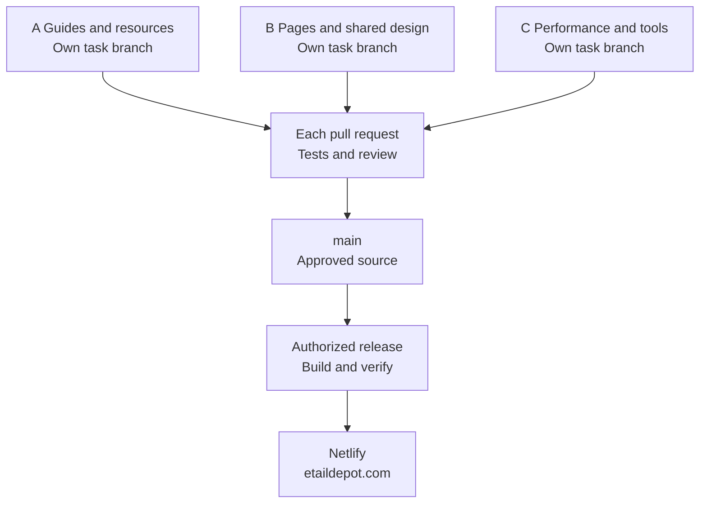

# Contributing to Etail Depot

Use this guide whether you write code yourself or use an AI assistant. The developer submitting a change is responsible for its scope, accuracy, tests and final review.

**Workflow:** agree the task → create a feature branch → build and test → review the diff → open a pull request → obtain merge authorization → deploy when authorized.

This repository runs Etail Depot's public website. The public **Developers** section is a customer-facing business area. Instructions for the people and AI tools working on this repository belong in this guide and `docs/`.

## 1. Agree the task and its stopping point

Use a GitHub issue or the agreed task conversation. Identify the person responsible for the work and the actual maintainer who can review or authorize it. An issue template is available under **Issues → New issue → Delivery task**.

Copy this brief:

```text
Task: [a short, specific name]
Outcome: [what the customer or project should be able to do]
Pages or work area: [URLs, business area or engineering files]
Preserve: [wording, pricing, artwork, URLs or behavior to keep]
Acceptance: [observable conditions that mean the task is complete]
Work owner and reviewer: [real people, agreed for this task]
Delivery: [proposal / local preview / branch and PR / merge and deploy]
```

| Delivery instruction | Authorized stopping point |
| --- | --- |
| Proposal | Inspect and recommend before editing. |
| Local preview | Implement and verify locally; provide the result for review. |
| Prepare for push | Review files, run the required checks and prepare a release summary. |
| Branch and PR | Push the reviewed feature branch and open a pull request. The live website is unchanged. |
| Merge and deploy | Complete review and checks, merge the approved candidate, then use the manual Netlify release process. |

One explicit instruction can authorize several stages. Preserve that authorization for the named task and candidate; do not ask again for the same action. A previous release approval does not authorize a different feature or a later unrelated release. Obtain the relevant maintainer decision before substantial changes to behavior, dependencies, commercial terms or architecture.

## 2. Read the current project instructions

Read these before editing:

- [README](README.md): project purpose and local setup.
- [AGENTS.md](AGENTS.md): scope, boundaries and required checks. AI assistants must read it too.
- [Project targets](project-targets.json): the permitted GitHub repository, Netlify site and denied resources.
- [Current work context](docs/CURRENT_WORK_CONTEXT.md): active work and the last verified release.
- [Source precedence](docs/SOURCE_PRECEDENCE.md): how to handle conflicting instructions.
- [Repository guide](docs/REPOSITORY_GUIDE.md) and [architecture](docs/PUBLIC_SITE_ARCHITECTURE.md): where changes belong.

Compare the recorded release with the actual current branch and GitHub state. Archived documents describe historical work and do not authorize restoring an old account or payment system.

For artwork or loading changes, also read [Page paint standards](docs/PAGE_PAINT_STANDARDS.md). For framework changes, read the installed Next.js documentation before choosing an implementation.

## 3. Start from the latest main in your own checkout

Each developer uses their own clone or worktree. A branch contains the whole repository; it is not a folder assigned to one person. Keep one focused task on each branch. Preserve any existing unfinished work before switching branches.

### Repository collaborator

For a new local checkout:

```sh
git clone https://github.com/nidcyj-haXqer-3disti/etail-depot-next.git
cd etail-depot-next
git fetch origin
git switch -c codex/services-payouts-copy origin/main
```

In an existing clean checkout, start with `git status`, then use the fetch and switch commands. Choose a descriptive, unused branch name. The `codex/` prefix is used for AI branches and triggers the existing branch CI. Never develop directly on `main`.

### External contributor using a fork

Create your fork on GitHub first. Replace `YOUR_GITHUB_USERNAME` below with your actual account name. The fork is `origin`; the Etail repository is `upstream`.

```sh
git clone https://github.com/YOUR_GITHUB_USERNAME/etail-depot-next.git
cd etail-depot-next
git remote add upstream https://github.com/nidcyj-haXqer-3disti/etail-depot-next.git
git fetch upstream
git switch -c codex/services-payouts-copy upstream/main
```

Do not add another `upstream` remote if it already exists. Confirm `git remote -v` points to your fork and the exact approved Etail repository. Contributor access and GitHub permissions are maintainer decisions, separate from the coding task.

### Install and preview

Install the Node version in `.nvmrc` and the pnpm version in `package.json`. Check those pins instead of selecting the latest versions. Use the existing lockfile.

```sh
node --version
pnpm --version
pnpm install --frozen-lockfile
pnpm dev --port 3100
```

Open `http://127.0.0.1:3100`. For a built preview, stop the development server, run `pnpm build`, then `pnpm preview`. The built preview exercises the hosting boundary; development mode is for editing. Stop preview servers and keep ports 3100 and 3101 free before running verification. See [local setup](docs/LOCAL_AND_CODEX_SETUP.md).

No production environment file, vendor credentials, database or merchant account is needed to develop the public website.

## 4. Put the change in its owning area

### Current layout and the three categories

The project has **website source**, **engineering support** and a **private workspace**. Business areas live inside website source. Technical code appears both in the website itself (`src/app/` and `src/shared/`) and in engineering support (`tools/`, `tests/`, hosting and CI). These labels describe responsibilities; they do not require separate repositories or new category folders.

```text
etail-depot-next/
├── src/                         WEBSITE SOURCE
│   ├── features/                [BUSINESS] Content, artwork and UI by business area
│   │   ├── home/
│   │   ├── services/
│   │   ├── use-cases/
│   │   ├── developers/          Public information for customers
│   │   ├── resources/
│   │   ├── company/
│   │   └── pricing/
│   ├── app/                     [TECHNICAL] URL entry points and root layout
│   └── shared/                  [TECHNICAL] Common UI, brand, styles and facts
├── public/                      WEBSITE SOURCE: approved public assets
├── .github/                     ENGINEERING: tasks, pull requests and CI
├── tools/                       ENGINEERING: shared build and verification tools
├── tests/                       ENGINEERING: automated checks
├── netlify/                     ENGINEERING: approved hosting boundary
├── patches/                     ENGINEERING: reviewed dependency fixes
├── docs/                        ENGINEERING: current project instructions
├── archive/                     ENGINEERING HISTORY: preserved, inactive records
├── README.md                    Project introduction and quick start
├── CONTRIBUTING.md              Human and AI contributor workflow
├── AGENTS.md                    Instructions AI contributors must follow
├── project-targets.json         Exact permitted repository and hosting targets
└── [root configuration files]   Build, dependency, test and hosting settings
```

The bracketed root-configuration entry above is a label, not a folder. Supplied documents and reference material belong in `local-work/input/`; generated reports, screenshots and documents belong in `local-work/output/`. Keep this workspace outside the Git checkout. Existing ignored tool state remains local. Engineering source is public in GitHub even though it is not served as customer pages.

The [detailed current folder map](docs/REPOSITORY_GUIDE.md) lists every active route and business-feature directory, shared code, public assets, engineering folders and all root configuration files. It also shows how a customer address connects to its feature. Use that map as the maintained reference rather than creating a second folder inventory in each team's notes.

**Business ownership answers what the customer sees and why. Technical ownership answers how pages are rendered, checked and released.** Both collaborate on the same repository. The public Developers feature is customer content; it is not the folder for contributors or their AI tools.

### Choose the owning area

| Work | Primary location |
| --- | --- |
| Home or Pricing | `src/features/home/` or `src/features/pricing/` |
| Services and use cases | The corresponding folder under `src/features/services/` or `src/features/use-cases/` |
| Public Developer content | `src/features/developers/` |
| Merchant setup, integration guides, Help and references | `src/features/resources/` |
| About, Contact, trust and legal content | `src/features/company/` |
| Page address or route entry point | `src/app/`, composed from its owning feature |
| Header, footer, logos, common UI or site facts | `src/shared/` |
| Checks, generators, packaging, CI or hosting support | `tests/`, `tools/`, `.github/` or `netlify/` |
| Contributor instructions and project records | `docs/` and the root contributor documents |

Keep a feature's content and artwork together. Reuse the existing Shell, design system and shared components. Shared code must not import feature-owned business content. Do not create a separate production tools folder for each developer. Personal helper scripts and review output stay in ignored local folders.

### Example A: edit an existing service page

**Task:** shorten the introductory copy on `/services/payouts`, keeping payout conditions, pricing and artwork unchanged.

- Start with `src/features/services/payouts/content.ts` and `page-content.tsx`.
- Keep the existing route in `src/app/services/payouts/`.
- Review the wording in context on desktop and mobile. Check wrapping, headings and the existing links.
- Explain any change to metadata or the meaningful content revision. Do not change dates just because a build ran.

### Example B: add a resource guide

**Illustrative future task:** build a Magento integration guide after its scope is approved. This example does not authorize or claim that integration is available.

- Research official provider instructions and separate verified steps from untested steps.
- Propose an owner under `src/features/resources/integrations/` and an approved `/resources/...` address in `src/app/`.
- Reuse the Shopify/WooCommerce guide patterns, including responsive artwork and the loading rules.
- Review navigation, the page inventory, metadata, revisions, sitemap eligibility and affected tests. Follow source and licence review before adding reference data or third-party assets.
- Use sanitized screenshots and clearly identified fictional examples. Record any provider access needed; do not claim a checkout or refund was tested without evidence.
- Coordinate changes to shared navigation or release counts with the maintainer. Change protected manifests only as part of the approved scope; do not adjust them merely to suppress a failure.

### Example C: fix a shared mobile footer

**Task:** correct an overlapping footer link at a specified phone width.

- Start with `src/shared/layout/footer-navigation.tsx`, `public-footer.tsx` and the relevant shared styles.
- Tell the maintainer that the change affects every page, and coordinate with anyone editing navigation or styles.
- Reproduce the issue, make the smallest appropriate correction, and check desktop and mobile representative pages, keyboard access and focus.
- Add a regression check when it protects the reproduced behavior. Do not duplicate the footer inside individual features.

## 5. Use AI with the same responsibilities

Give the AI the approved task and repository instructions. Review its proposed scope, changed files and evidence yourself before submission. Never give it production secrets, customer records or unredacted account screenshots as ordinary task context. Check external source facts and licences before accepting generated content.

Copy this prompt and replace the brackets:

```text
Work on the Etail Depot public website.

Task: [approved outcome]
Affected pages: [URLs or business area]
Preserve: [content, behavior and destinations to keep]
Acceptance: [observable checks]
Authorized delivery: [proposal / local preview / branch and PR / merge and deploy]

Read AGENTS.md and its required current documents before editing.
Check the latest main and preserve existing unrelated work.
Use a separate feature branch and the owning feature folder.
Coordinate shared-file changes with the task maintainer.
Follow the existing account, publication and page-loading boundaries.
Review the diff and run the checks appropriate to the change.
Report what changed, actual test results and anything not verified.
Stop at the authorized delivery stage.
```

An AI completion message is not evidence by itself. Inspect the diff and test output. Do not approve generated provider instructions, commercial claims or legal wording merely because they sound plausible. Keep the public Developers section separate from project-team management; adding that section does not create an Etail API or SDK.

## 6. Test and inspect before submission

For application changes, run `pnpm verify`. It runs the following release sequence in order:

```sh
pnpm verify:public
pnpm test:seo:production
pnpm package:netlify
pnpm verify:package
```

Install the browser required by the tests first: `pnpm exec playwright install chromium`. On Linux, use `pnpm exec playwright install --with-deps chromium` when system dependencies are needed. Use the pinned runtime in local and CI checks. Do not run the four release commands concurrently against the same build output.

For documentation-only changes, check linked files, commands and formatting, and report which application checks were not rerun. Every release candidate still requires all four commands. See [Testing and evidence](docs/TEST_AND_EVIDENCE.md).

For UI changes, also inspect affected desktop and phone flows: keyboard navigation, visible focus, wrapping, overflow and the relevant loading behavior. Use the [paint standard](docs/PAGE_PAINT_STANDARDS.md) for first visits, refresh and saved section links. Record actual failures, corrections, reruns and skips. Never weaken tests to manufacture a passing result.

Before committing:

```sh
git status --short
git diff --check
git diff
pnpm test:publication
```

Stage only the intended files. For example, a copy-only Payouts task might stage `git add src/features/services/payouts/content.ts`; include other files only when the reviewed task actually changed them. Review `git diff --cached` before committing.

Commit the reviewed local change with a specific message, for example `git commit -m "Clarify the payout page introduction"`. A local commit records your work; it does not upload it or change the live website.

New private documents and review material belong in the external `local-work/input/` and `local-work/output/` folders. Read `.local/workspace-paths.json` when present for the configured location; keep that pointer private. Existing `.local/` tool state and compatibility shortcuts stay ignored. Credentials belong in approved private storage. `public/` is publicly served. GitHub is public too, including repository-only documents. A filename classification does not prove its contents are safe. Never commit credentials, private captures, customer records or generated `.next/`, `out/` and `.netlify/` output. See [File publication policy](docs/FILE_PUBLICATION_POLICY.md).

## 7. Update the branch and open the pull request

### How several developers work together

Each developer works on their own task branch. A, B and C are example assignments; people can use AI or code manually.



A **branch** holds one task's changes. A **pull request** proposes those changes for review. Each PR needs its own checks and merge authorization. After another PR merges, update the remaining branches and recheck them. Release the verified result only when deployment is authorized.

All contributors use the same project tools. Coordinate shared files, such as navigation and styles. The [second diagram](docs/REPOSITORY_GUIDE.md#how-private-work-becomes-the-public-website) shows the private workspace and merchant portal boundary.

If `main` has changed, first commit your reviewed work and confirm `git status` is clean. From your feature branch, collaborators use:

```sh
git fetch origin
git merge origin/main
```

Fork contributors use `git fetch upstream` and `git merge upstream/main` instead. Resolve conflicts with the relevant developer or maintainer, then retest the combined candidate. Never choose all of one side just to finish a merge, reset another person's work, or force push shared history. Separate files can still have incompatible assumptions.

**Two-developer example:** one developer edits Payouts and another edits the WooCommerce guide, each on their own branch. If the Payouts PR merges first, the guide developer brings the new `main` into their branch and checks the combined result. If both changed the footer or navigation, they review those changes together before the second merge. Neither copies a whole folder over the other developer's work.

After review and push authorization, a collaborator using the example branch can run:

```sh
git push -u origin codex/services-payouts-copy
```

Use your actual branch name and reviewed commits. For a fork, `origin` is your fork. Open **Pull requests → New pull request** on the Etail repository, choose `main` as the base and your feature branch as the comparison. For a fork, choose **compare across forks** and select your fork's branch.

Complete the existing PR template. A good description names the resulting behavior, affected area, verification and limits:

```text
Outcome: Shorten the Payouts introduction while retaining funding conditions.
Implementation: Payouts feature copy; public address and artwork unchanged.
Verification: [actual commands, exit results, commit and UI checks]
Limits: [anything not tested; state whether production deployment occurred]
Release: [authorized next stage]
```

Wait for the upstream `public-website` check on the exact candidate. A passing check from an earlier commit or a fork-local run does not satisfy the upstream requirement. The workflow is bound to the Etail repository ID; a maintainer may need to approve a new contributor's upstream run. Do not change that identity check or GitHub protection to bypass a failure. Follow [GitHub delivery](docs/GITHUB_DELIVERY.md).

## 8. Review, merge and release

The actual maintainer reviews scope, files and evidence before an authorized merge. Passing CI does not grant merge or deployment permission. Use the current branch protections and inspect any new changes to `main` before merging. Do not invent reviewers or CODEOWNERS entries. Permission and protection changes are separate settings actions.

If deployment is authorized, verify the merged commit and its checks, then follow the [manual Netlify runbook](docs/NETLIFY_DEPLOYMENT.md). Use only the existing bound site and reviewed Git build. Record the deployed commit, deploy ID and live verification. Do not publish the repository root or replace the approved procedure with a static-only upload.

Finish with a short handoff:

```text
Task and result:
Branch, commit and PR:
Files and public pages changed:
Checks run and their results:
Known limitations or checks still needed:
Delivery status: local / pushed / merged / deployed
If deployed: deploy ID, commit, live URL and hosted checks
```

Keep `docs/CURRENT_WORK_CONTEXT.md` accurate for the active task and release, coordinate edits to that shared record, and preserve dated stage receipts. Do not copy old passing totals into a new completion claim.

## Boundaries that every task preserves

- Merchant sign in and registration use the fixed [Trolleys Welcome page](https://merchantapp.io/etaildepot/UserAccount/Login) through the existing shared link component, without referrers or forwarded visitor input. Do not add an Etail account application, payment runtime, API, KYC, ledger or database adapter. Card applications remain closed.
- Preserve approved pricing, eligibility, legal provisions, source notes, reference licences, one shared Shell and the design system. Reference-data changes require source, licence and scope review. Keep excluded reproduced ISO tables out of public source and packages.
- URL changes require explicit scope, a complete link/canonical/sitemap review and redirects where appropriate. Preserve the exact production indexing guard, preview noindex and empty preview sitemap.
- Use only the targets in `project-targets.json`. Preserve denied projects, databases, Identity, DNS and email settings. Keep the enabled Netlify Emails extension and its pinned authenticated handler. Retirement routing must not read or forward submitted bodies. Do not modify archived migrations or run retired provisioning scripts.
- Use plain language and preserve required technical identifiers. Personal AI tools can differ; shared dependencies, the lockfile, tests and release tools belong to the project.

For website bugs, open an issue with the page, reproduction steps and browser/viewport. Product questions belong in the [Help center](https://etaildepot.com/resources/help). Send potential vulnerabilities privately to [compliance@etaildepot.com](mailto:compliance@etaildepot.com), not to a public issue.
