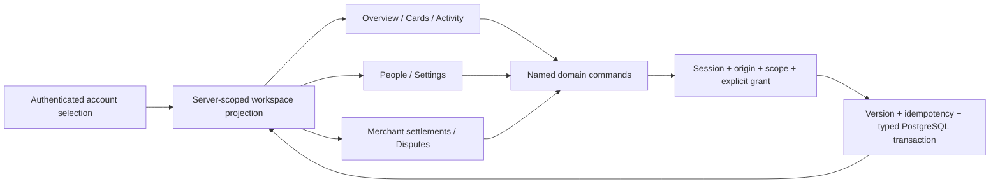

# Etail account experience: architecture and design

9 September 2026. User direction: deepen front-end research with creators/reviewers, then architect, design, build and show the result. Evidence: [inspected Amex screens](research/amex/FRONTEND_EXPERIENCE.md), [reviewer walkthroughs](research/amex/REVIEWER_WALKTHROUGHS.md), and the normative [UX contract](UX_CONTRACT.md).

## Screen architecture

| Destination | Primary job | Connected next step |
|---|---|---|
| Account directory and persistent selector | Choose Personal, Household or Merchant explicitly | Selection is validated and persisted before navigation |
| Overview | Understand the selected account, available amount, obligations and recent activity | Same Cards, Activity and Get paid destinations as navigation |
| Cards | Inspect holder, card state and effective limit | Freeze/unfreeze confirmation; one saved Add card request with details, review and prerequisites |
| Activity | Search and filter dated entries | Transaction detail; preserve filter/list context; open contextual support |
| Statements & reports | Review an explicit period and permitted data source | Exact itemized historical totals, scoped CSV, print, private saved report filters |
| Get paid, Merchant only | Separate payable, pending settlement, reserves and commercial spending | Settlement breakdown; dispute queue, timeline, saved response and review submission |
| People & controls | See who has access and what each person may do | Named-person invitations, explicit delegation ceilings, reviewed changes and revocation |
| Membership | Compare Select/Premier and understand reward timing | Server-calculated annual planning estimate; unknown brand costs remain unknown |
| Settings | Review account identity and notification choices | Save versioned preferences; truthful delivery status |
| Sign-in & security | Review this person's active sign-ins | Revoke selected other session families; preserve the current and later independent sign-ins |
| Help | Find contextual guidance while keeping account selection | Create, follow up and withdraw a creator-private support case; optional permitted transaction context |

React formats supplied values and invokes commands; it never calculates eligibility, posts money or calls a provider. UI receives type-only contracts. The existing account and Identity services remain the authority. One policy evaluator checks scope and explicit grants. A cardholder choice comes from the server, not a browser interpretation of role. All Add card links open the same component and saved request lifecycle.

## Visual design

Original Etail logo, deep forest ink, muted teal accents, warm off-white canvas and restrained white panels. A persistent desktop side navigation and compact mobile navigation keep account context stable. Large financial values have precise labels; activity and merchant tables carry quieter visual weight. Card geometry uses Etail colors and typography, without Amex artwork or marks. Status badges use text as well as color. Controls have visible focus, accessible labels and touch-sized targets.

The first screen is useful to a returning member. Its main balance, card summary, recent activity and next action lead into the same full destinations. Household funded amounts never masquerade as a minor's borrowing capacity; Merchant payout amounts never merge with card spending capacity. There is no invented membership tier, benefit rate or marketing promise.

## State and implementation boundary

The review build is an isolated local sandbox. Typed fictional historical snapshots supply money/activity/settlement examples; they are **not a financial ledger** and have no write path. They cannot back a real issuance/payment decision. Commands persist card control state, card-request drafts and prerequisite results, dispute response/timeline state, and notification preferences in PostgreSQL. Draft submission does not mint a card. A dispute submitted for review is not a resolved chargeback. Saved notification settings do not imply delivered email.

Every write has explicit person/account/resource scope and server validation. Versioned servicing commands use unique command IDs and expected versions; session revocation monotonically targets the selected owned session families. Transactions recheck live authority and reject stale writes. The isolated-fixture identity and host guards stay enforced. No customer data, provider credentials, private Amex systems or external services are used.

The second local delivery adds three explicit servicing owners: `access`, `cases`, and `reports`. Access writes use the same account advisory-lock key and policy evaluator as existing workspace commands. Invitations bind one intended fictional identity and the exact offered permissions; acceptance rechecks the sender's current delegation ceiling. Revocation invalidates related pending invitations and subsequent account access without erasing history. The account directory exposes the intended person's invitation inbox.

Support cases are private to their creator within an accessible account. A follow-up appends to a versioned timeline; withdrawal requires a reason. They do not represent an issuer chargeback, agent reply or external submission. Saved report definitions store filters only; every rerun/export rechecks the permitted sources and loads current scoped records. Historical report totals never change financial balances. CSV text neutralizes spreadsheet formulas; exports remain private and uncached.

Sign-in controls reuse the sole opaque-session store. Current authentication is rechecked while binding locks are held; revocation names specific session families rather than a reusable broad "all future sessions" operation. Tokens/hashes are not returned to the UI. The membership calculator consumes source commercial rules, computes exact estimate arithmetic server-side and rounds only display values. It does not activate a plan, calculate an earned balance or settle an economic-policy decision for future posting.

The header's task search shows only relevant destinations for the current account and capabilities. It navigates to the existing workflows; it never starts a mutation by searching or selecting a destination. Transaction details link directly into scoped support. The retained 90-task [gap audit](../planning/EXPERIENCE_GAP_AUDIT.md) makes further completion work explicit.

Actual payment, purchase, refund, payout and issuance execution remain dependent on the normative ledger, eligibility, provider and unresolved commercial milestones. Their affected writes remain blocked. This front-end work does not mark M1–M5 complete or silently replace the planned single ledger with a second mock finance system. Local fixture records are the same typed servicing domain records used by the supported commands; future financial services must feed validated projections through their owning modules.

## Verification target

Verify account switching and privacy; card freeze persistence across reload; one saved request and explicit unmet prerequisites; filtered transaction detail; Merchant settlement trace; dispute draft/review persistence; settings save; invitation acceptance/revocation/ceiling races; creator-private support; scoped report export and retry recovery; session revocation; source calculator regression; desktop/mobile reflow; keyboard dialog focus; automated accessibility. Run actual build, lint, types, unit, integration, contract, concurrency, architecture and security checks. The current target is 100% of the retained comparison tasks; verified parity remains unassessed until its evidence dimensions are independently reviewed.
