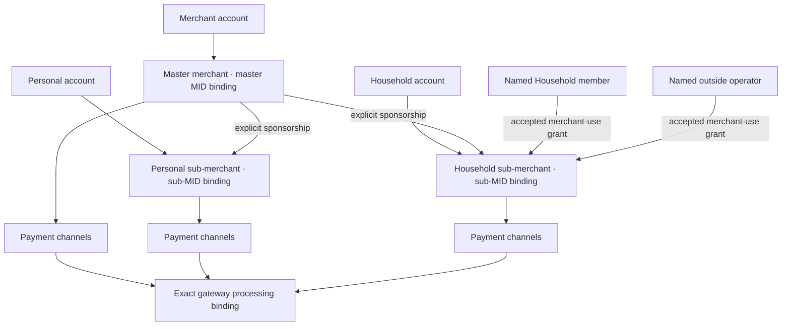
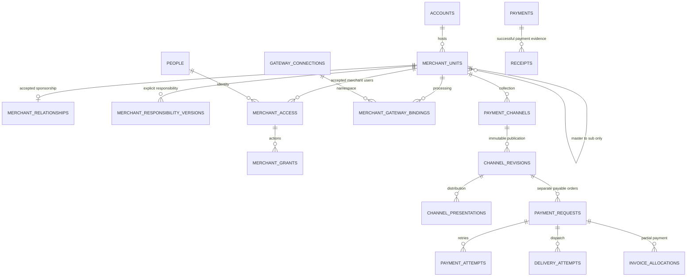

# Merchant hierarchy and payment channels

9 September 2026. **Local hierarchy, merchant access and payment-channel drafts are implemented and locally tested; financial processing and provider integration remain future work.** The user's latest direction supersedes the Merchant-only entry model in D40–D41: Merchant has the master merchant relationship/MID; Personal and Household have sub-MID relationships; Household can delegate their use to household members or other named people. Payment channels replace the customer-facing payment-draft concept. Exactly three account types and one policy engine remain. Future financial implementation must preserve one canonical payment/ledger owner; this slice adds no ledger.

Companion contracts: [machine-readable design](../contracts/merchant-channel-design.json), [verification scenarios](../planning/merchant-channel-verification.json), [provider reference](research/acquiring/MERCHANT_HIERARCHY_REFERENCE.md). The [generated executable OpenAPI](../contracts/generated/foundation-openapi.json) describes the implemented API. The seventh migration is immutable and has recorded application/preservation evidence on the isolated test database and local preview database; no hosted deployment or provider connection is established here.

### Implemented local boundary

- Typed MASTER/SUB units, one immutable master per SUB, multiple Merchant associations and one unit per master/host pair. A named host requests a relationship; host and master confirm separately. Authorized controllers can review pending/suspended relationships, and suspension blocks channel operations.
- One merchant scope loader and the existing policy evaluator; Merchant-owned administration within the account shell, limited merchant-only navigation for outside helpers, named-recipient invitations, accepted resource assignments, explicit delegation ceilings/lineage, expiry and revocation. The current invitation slice permits Household SUB delegation only; it adds no outside helper to the Household account.
- One payment-channel form and merchant-scoped create/edit/close commands. Seven selected presentation types, exact USD draft amounts, one-time/reusable intent, expiry, creator-private or explicitly assigned visibility, optimistic versions and replay recovery persist locally. Existing Merchant drafts keep their IDs and private ownership. A channel remains a saved configuration, not a payable order.
- Existing fictional Merchant creation and merchant-application preparation remain available through their canonical account workflows. Their declarations and local review do not prove legal identity or provider approval.

Not implemented by this slice: provider verification records/evidence storage, external MID assignment, gateway bindings, public checkout/tokens, channel activation, distribution, SMS/email transport, QR/public-link generation, issued invoices/bills/receipts, payment requests/orders, payment processing, refunds, payouts, or new financial state. Readiness explicitly reports `NOT_VERIFIED`, `NOT_CONNECTED`, `externalMid: null`, no payment acceptance/payouts, and commercial spending `NOT_ASSESSED`. `canPublish` is always false. The extended architecture below is a **target** where it exceeds this local boundary; test-source references alone are not execution evidence. [Current delivery evidence](MERCHANT_CHANNEL_EVIDENCE.md) records actual local runs and their source revision.

## 1. The account and merchant model



The gateway box is future architecture; no gateway binding is created by the local slice. It represents the binding mechanism, not one shared default processing account. Every active merchant/channel resolves its own explicit binding. A sub-MID has exactly one immutable master parent. A gateway connection can serve several approved bindings; the account, merchant resource, provider processing account and legally responsible party are distinct records.

| Account | Acquiring experience | Permission boundary | Issuing remains |
|---|---|---|---|
| Personal | Quick Sell selects its own authorized sub-MID, shows the sponsoring Merchant, and creates/uses channels in that merchant context. | Personal account access remains owner-only. A sponsor receives no Personal card, balance or activity access. Personal merchant access is owner-only by default; no new helper-delegation default is introduced here. | Separately approved consumer spending and existing card controls. |
| Household | Get paid / Help a Merchant operates the Household's authorized sub-MID. A permitted controller delegates exact channel use to members or outsiders. | Household membership is not merchant authority. Merchant access is not Household membership. Outside helpers never gain Household cards, balances, member directory or spending history from a sub-MID invitation. | Existing approved adult allocations and guardian-funded supervision; no independent minor borrowing. |
| Merchant | Merchant services within the Merchant account shows its master MID, child sub-MIDs, gateway readiness, permitted merchant activity and control settings. It also has its own payment channels. | Master oversight is an explicit merchant capability. It covers agreed merchant operations, not the host accounts' financial records or creator-private drafts. | Separately approved commercial spending; merchant approval creates no card or spending capacity. |

An account can exist before its merchant relationship is established. Account creation, relationship acceptance, merchant verification, MID assignment, gateway readiness and channel activation have separate states. Creating or selecting a sub-MID cannot silently register a merchant, accept terms, create settlement entitlement or approve issuing.

### Confirmed product choices

The user explicitly confirmed both choices on 9 September 2026:

1. **Master Merchant responsibility:** sales, fees, refunds and chargebacks belong to the master Merchant. Sub-MIDs are delegated collection units with separate activity attribution, not independently responsible merchants. Store the responsible Merchant explicitly on the unit and resulting economic records. Provider merchant-of-record, debit routing, beneficiary and payout configuration must implement this accepted responsibility model; gateway parentage alone is not the evidence.
2. **Multiple Merchant associations:** a Personal or Household account may hold separate sub-MIDs under multiple Merchants. Every sub-MID has exactly one immutable master. Enforce one unit per master/host pair; choosing another Merchant creates a separate relationship, never reparents existing transactions or private drafts.

The responsibility label is **Responsible Merchant: [name]**. The local readiness state remains **Gateway not connected** and **MID not assigned** until an actual configured provider supplies that evidence. These product choices do not themselves enable financial processing or settle provider-program availability.

## 2. Merchant identity and gateway assignment — provider target

Use an internal immutable `merchantUnitId` UUID in application routes, grants, channels and payment provenance. A provider MID is a typed external assignment, displayed only after the actual adapter has assigned/verified it. Mock identifiers are clearly marked `MOCK`; never display a made-up value as a live MID.

Braintree distinguishes gateway-wide `merchantId` from transaction-routing `merchantAccountId`, and omission can route a transaction to a default account. Adyen distinguishes company, merchant account, store and legal entity. Therefore the application must always supply and validate the exact provider/environment/processing binding and must never fall back to another MID. [Braintree identifiers](https://developer.paypal.com/braintree/articles/control-panel/important-gateway-credentials), [Adyen account structure](https://docs.adyen.com/account/account-structure/).

Provider connection configuration owns secret references; merchant bindings contain non-secret routing references and versioned capabilities. A platform/master gateway key is never handed to a Household operator. Bindings include provider, environment, identifier namespace/connection, external identifier type/value, processing account, applicable master binding, program/charge-flow/acquiring region, supported currencies/methods, assignment status and effective version. Record the actual refund/dispute debit-account routing as well as ultimate liability. A store ID or connected-account ID is not relabeled as an acquiring MID. Provider resources are unique within their documented namespace; several explicitly approved Etail bindings may reference one processing resource where the provider supports it.

Merchant-of-record identity and which balance absorbs refunds/disputes are not necessarily the same thing. Provider charge configuration must match the chosen legal/settlement model and customer-facing merchant descriptor. [Stripe merchant of record](https://docs.stripe.com/connect/merchant-of-record), [Stripe charge responsibilities](https://docs.stripe.com/connect/charges).

### Verification details and management workflow

Use a requirements checklist and timeline for each subject, with **Required information → Submitted → Provider review → Action required / Capability update → Continuing review**. These are presentation stages; store the provider's actual status and capability fields separately. Every requirement names its responsible actor, source and current state, plus a nullable provider-supplied deadline. No deadline does not imply no restriction. No deadline or approval is invented.

| Subject | Information and evidence to associate | Gate and customer experience |
|---|---|---|
| Merchant master | Declared individual/sole trader/company legal form, country, legal/trading name, business activity, authorized representative, applicable provider-required associated people and agreement version. Sensitive future evidence remains with an approved provider-hosted flow or restricted evidence service. | Owner sees the master's requirements. Account role is not representative authority. Provider-specific requirements determine which fields are necessary. |
| Personal sub-MID | Host owner, named master, proposed activity/trading identity, responsibility version, explicit host/master acceptance and required provider registration. | Personal owner can prepare the relationship under the responsible master Merchant. Provider registration and any required associated-party checks still apply; independent sub-merchant liability is outside the accepted model. A private Personal account is not itself proof of merchant eligibility. |
| Household sub-MID | Authorized host controller, master, activity, responsible legal party/representative, accepted controls and relationship terms. | Household is a sharing context, not an automatic legal merchant. Master verification does not automatically exempt the sub-unit from registration/requirements. |
| Household member or outside operator | Verified intended application person, accepted sub-MID invitation, exact actions/channels/limits, expiry, delegator lineage and any continued-membership dependency. | Verify access separately from business review. A helper cannot complete the merchant's legal review merely by accepting an invitation. Supervised collection stays unavailable without supported guardian/product requirements. |
| Gateway and MID | Exact provider/environment/namespace/resource assignment, supported program/region/charge flow, descriptor, requested and effective acceptance capabilities. | Show **MID pending**, **Assigned**, or the actual restriction without inventing an identifier. A returned MID does not by itself make payments available. |
| Settlement and payout | Chosen settlement beneficiary, loss/debit routing, verified destination reference and distinct transfer/payout capability. | Payment acceptance and payout have independent readiness. No real bank details are requested or stored in the sandbox. |
| Channel and delivery | Authorized merchant revision, allowed currencies/methods/presentations, public audience review, message transport readiness and recipient eligibility where applicable. | A saved channel can remain a draft while gateway or transport setup is missing. Provider-accepted message dispatch is not proof of delivery or payment. |

The exact legal/business checklist is provider, country, legal-form and product dependent. Use the provider's current required fields rather than a universal ownership percentage, document list or turnover threshold. [Stripe identity verification](https://docs.stripe.com/connect/identity-verification), [Adyen verification requirements](https://docs.adyen.com/platforms/verification-requirements).

Persist typed verification subjects, representative relationships, requirement codes/state/errors, evidence references, supplied deadlines, capability flags, observation time and source event/version. Sign-in verification, legal identity review, representative authority, merchant review, MID assignment, acceptance and payout are distinct dimensions. Use protected references instead of raw documents in ordinary merchant tables or activity logs. The current sandbox accepts only fictional declarations and must never display these as real KYC/KYB decisions.

Re-review does not necessarily disable every capability: Stripe separates payment and payout enablement, and Adyen can retain an allowed capability during some reviews. Evaluate current provider `allowed`/`enabled` or equivalent flags together with local restrictions, freshness and the requested action; do not grant new authority from a generic “verified” field or blindly revoke every capability because one review is pending. Missing/stale evidence beyond the adapter's explicit freshness policy triggers reconciliation and blocks affected new dispatch. [Stripe verification updates](https://docs.stripe.com/connect/handling-api-verification), [Adyen capabilities](https://docs.adyen.com/platforms/verification-overview/capabilities).

Changed business details and periodic reviews reopen only their applicable requirements. Retain historical decisions and invalidate stale capability projections; later events never rewrite the identity/routing snapshot of an accepted payment. Show **Who needs to act**, **What is missing**, **Which service is unavailable** and an authorized resume action. [Adyen continuing verification](https://docs.adyen.com/platforms/verification-overview).

## 3. Permissions and delegation

The implemented evaluator accepts typed account/merchant contexts. The conceptual target union is:

```ts
type AccessTarget =
  | { kind: "ACCOUNT"; accountId: string }
  | { kind: "MERCHANT_UNIT"; merchantUnitId: string };
```

`loadAccountScope` remains the financial-account loader. The implemented transaction-aware `loadMerchantUnitScope` handles merchant operations. Both feed the same `evaluate` function. For operating actions, the merchant loader verifies the resource, immutable root, accepted sponsorship when the unit is SUB, host operational state, direct/oversight grant, authority lineage, action restrictions and product prerequisites. MASTER roots have no parent-sponsorship predicate. It does not require an outside helper to belong to the host account and does not bypass the Personal privacy guard.

Use distinct server-loaded contexts within this same evaluator: (a) operating merchant actions use accepted current access; (b) pending relationship review/acceptance uses the named host controller or master authority and reveals only the offer, without requiring preexisting child access; (c) invitation decisions use the exact intended recipient and pending offer; (d) public checkout uses only the scoped guest token and live operational gates. An offer decision is not permission to operate the merchant. Ordinary account work retains its account context.

The implemented grant vocabulary is `merchant.read`, `merchant.people.read/invite/revoke`, and `channels.read/create/update/close/share`. Relationship request is an account-scoped command; side acceptance/suspension uses the merchant review context. Invitations select explicit actions and onward-delegation permissions within the live ceiling. Only accepted Household SUB units expose invitation/revocation management in this slice. Access expiry starts when the invitation is saved, independently of its invitation deadline; the review displays the exact expiry. Per-channel invitation assignments, type/amount ceilings and public guest operation are future additions, not current invitation fields.

Roles below are **target reviewable permission presets**, not implemented roles or unconditional grants. Financial, distribution, collector and activation actions in this table remain unavailable:

| Merchant permission | Master administrator | Authorized Household sub-MID manager | Collector / outside operator | Merchant viewer |
|---|---|---|---|---|
| Read merchant identity/readiness | Explicit master/approved descendant scope | Assigned sub-MID | Assigned sub-MID, minimum information | Assigned read scope |
| Establish sub-MID sponsorship | Specific authority plus host acceptance | Request/accept for the host within explicit authority | No | No |
| Configure gateway/routing or legal/settlement settings | Separate elevated permission and applicable approvals | No default | No | No |
| Create/edit channels | Own/explicit managed merchant scope | Assigned sub-MID within master ceiling | No default; may create payable requests using assigned active channels | No |
| Activate/pause channels | Explicit permission plus current readiness | Only if delegated; cannot override master restrictions | No default | No |
| Distribute SMS/email/social/QR/web representations | Explicit action and allowed channel types | Explicit action and allowed types | Assigned channels/types, amount limits and expiry | No |
| Invite/change/revoke merchant users | Within explicit delegable authority | Within its own live ceiling; no master-wide grants | No onward delegation by default | No |
| Read payment records | Agreed master oversight, merchant records only | Assigned shared sub-MID records | Own/assigned transaction scope only | Explicit assigned report scope |
| Refund, payout or change payout destination | Separate financial permission; chosen responsibility model and approval gates apply | No default | No | No |
| Issue cards, spend or view host financial accounts | Requires separate account/facility authority | Requires separate account/facility authority | None from this invitation | None from this invitation |

For operating merchant actions, effective authority is the intersection of: authenticated identity, accepted unexpired resource access, the still-valid grant lineage, accepted master/host relationship for SUB units, master ceiling, sub-MID controls, permitted channels/amounts, resource visibility and action-specific prerequisites. A child can narrow but never relax a parent. No wildcard grant to all present/future descendants.

For a Household member, the review can bind merchant access to continued Household membership; show this dependency explicitly. For an outside operator, use direct merchant access without creating account membership. A household member leaving invalidates access that depends on that membership; a separately accepted direct merchant appointment is separately managed and visible as such. Revoking a grant permanently invalidates its descendants; issuing a replacement grant never revives an old delegation chain.

A supervised person cannot independently establish a merchant relationship, select responsibility, invite others, change routing, refund or request payouts. Supervised collection, if later enabled, requires an explicit verified guardian/age/product policy and narrow assignment; it remains unavailable while those prerequisites are missing.

### One invitation lifecycle

Evolve the existing invitation target into a discriminator with real foreign keys: exactly one of `accountId` or `merchantUnitId`. Retain the existing intended-recipient inbox and `PENDING → ACCEPTED | DECLINED | REVOKED | EXPIRED` lifecycle. Account acceptance creates account membership as today. Merchant acceptance creates merchant access only.

The implemented merchant invitation records the exact recipient, merchant/sub-MID, sponsoring Merchant, actions, delegable actions, invitation expiry, access expiry, membership dependency and authority lineage/version. Future invitation restrictions may add permitted channel IDs/types and amount/currency ceilings; they are not currently persisted or enforced. Review says **“Access to [merchant] only. This does not share [Household]'s financial account.”** Declining has no grant effect. Acceptance rechecks the grantor, relationship, current ceiling, guardian prerequisites and invitation version. It cannot use a stale link to restore permission.

Existing local fictional people support the first test slice. Future email/phone invitations require verified intended-person binding and configured delivery; an email string alone is not identity. This redesign does not send invitations, SMS or email to real people.

## 4. Payment channels and one payment lifecycle — drafts now, collection target

**Payment channel** is the product's saved collection configuration under one merchant. It has a name/purpose, fixed currency, amount/request rules, one-time or reusable mode, expiry, permitted presentation types, visibility, policy and lifecycle. **Draft** becomes a status within Payment channels, not a separate product destination.

The seven presentation choices below are saved on the local draft. Their delivery/document/payment behaviors describe the future target and cannot currently be invoked. Receipt is explanatory post-payment behavior, not an eighth draft presentation.

| Requested surface | Target canonical model and customer behavior |
|---|---|
| SMS / text | One delivery type. A reviewed message contains the canonical channel/order link. Recipient, consent/eligibility, dispatch and delivery outcome are separate from payment. |
| Email | Delivery of the same channel/order link and approved document references; no email credential in the merchant UI. |
| Invoice | A payable numbered document with itemization and remaining amount, linked to a payable request; supports the existing partial-payment allocation requirement. |
| Receipt / bill | **Bill** is an unpaid payable document. **Receipt** is generated from an authoritative successful payment and records subsequent refund corrections. A bill cannot become a paid receipt merely because it was sent. |
| Social media | A shareable canonical URL/approved presentation. Copying or opening a share composer does not mean the social post was published. |
| QR code | Encodes the same canonical channel/order URL. Scanning does not create a charge or reveal merchant-management access. |
| Website / online link | Hosted payment URL or permitted website integration under the exact MID. Domain/embed policy is explicit; it is not a second checkout/payment engine. |

Distinguish four records: channel definition → payable order/request → payment attempt/effect → delivery/document. Sending the same invoice through SMS, email and QR references the same obligation. A reusable channel creates independent payable orders for deliberate purchases; it must not reuse one payment identity forever. Opening a link can create a checkout session without charging it. [Stripe reusable Payment Links](https://docs.stripe.com/api/payment-link).

One-time channels reserve exactly one payable order across all presentations and revisions; retries and concurrent public opens resolve that same order. Editing a channel never resets its consumed use. One-time requests permit at most the intended successful principal; concurrent attempts cannot double-capture. Partial invoice payments reserve/allocate against the remaining amount atomically. Reusable channel revisions are snapshotted on each new order, so later edits cannot reroute an in-flight payment. Financial state comes from the common acquiring handlers and one ledger, never a delivery flag or browser redirect.

Public presentation tokens are opaque, stored as hashes, and limited to one channel, audience, expiry and permitted guest actions. A stable reusable-channel token may resolve its currently active revision; each resulting order/checkout token binds the exact order and immutable merchant/responsibility/gateway snapshot. Public token possession never grants access to `/merchants/` management routes, private documents or account APIs. Pause, expiry, master restriction or relationship suspension blocks new checkout/payment submissions through previously distributed URLs; already accepted financial effects still reconcile. Do not place recipient personal data or management credentials in QR payloads, tokens or URLs.

### Separate statuses

**Current local mapping:** the physical `payment_request_drafts.status` retains `DRAFT` or `CANCELED`. The API additionally derives `EXPIRED` from time; the UI labels `CANCELED` as **Closed**. Closing uses `/channels/{channelId}/close` but does not change the stored enum or add `closure_reason`. A closed channel never reopens. Relationship commands implement request, two-sided acceptance and suspension; `CLOSED` is a supported relationship storage value without a local close command. The remaining statuses below are the broader target, not reachable local financial/provider states.

- Relationship: `REQUESTED`, `ACCEPTED`, `SUSPENDED`, `CLOSED`; rejection/withdrawal belongs to its request history.
- Merchant verification/MID assignment: unmet requirements, pending, assigned/verified, restricted, declined or closed, with explicit provider/mock basis.
- Channel configuration: `DRAFT`, `READY`, `ACTIVE`, `PAUSED`, `EXPIRED`, `CLOSED`. `READY` is server-derived from requirements; `ACTIVE` requires the publication command and gateway/provider prerequisites.
- Delivery: `QUEUED`, `DISPATCHING`, `SENT`, `DELIVERED`, `FAILED`, `CANCELED`, `UNKNOWN`, according to actual transport evidence. QR/link preparation has a generated/prepared outcome, not a fabricated delivery confirmation.
- Payment: existing authoritative authorization/capture/settlement/refund/dispute lifecycle. “Sent,” “opened,” “scanned” and “checkout returned” do not mean paid, settled or available for payout.

Receipts require a successful payment and are regenerated/corrected through immutable document versions rather than altering payment history. [Stripe receipts](https://docs.stripe.com/receipts).

## 5. UI/UX structure

Keep the current account switcher and issuing navigation. Within Get paid, add a separate merchant selector showing **“[Sub-merchant name] · Under [Merchant name]”** and MID assignment/readiness. The selected merchant never silently changes the financial account. Store a validated `merchantId` in the route and recheck it on every load.

Primary management home: **Merchant account → Merchant services → Own merchant & Sub-MIDs**. Selecting the master or a child keeps the Merchant account selected at `/accounts/{accountId}/get-paid?merchant={merchantId}&merchantTab=channels|people|verification`. The account must own that master; account membership and the current unit scope are both checked. Personal Quick Sell and Household Help a Merchant retain their own account shell and can select only their host units across accepted Merchants. All views render the same channel, permissions and verification components and invoke the same canonical merchant APIs.

An outside helper opens **Shared selling access** from accounts/invitations. `/merchants/{merchantId}` remains a compatibility and invitation entry: it resolves only that unit's authorized responsible Merchant, then its authorized host, otherwise a limited collection workspace. Helpers receive no financial account projection or account selector from their merchant grant. The responsible Merchant remains named. Forged account/unit pairs fail without selecting another merchant. This is a scoped view, not a fourth account or a separate merchant-service owner.

Implemented merchant destinations are **Payment channels · People & permissions · Verification & gateway**, with People capability-filtered. The future full navigation is **Overview · Payment channels · Payments · People & permissions · Gateway & setup · Reports**, each capability-filtered. Merchant's merchant network adds explicit child selection/oversight. Refunds/payouts remain action-specific servicing within the common payment/financial workflow. No new general CRUD dashboard.

One **New payment channel** form: choose permitted merchant → name/purpose and one-time/reusable rules → amount/currency/expiry → presentation types → audience/access → review exact merchant, responsibility/readiness and publication consequences → save draft or activate when permitted. SMS/email recipients are entered at distribution time, not required to create the reusable channel. Receipt is a post-payment option, not an activation route that pretends a payment occurred.

The future collector's **Use channel** journey starts from assigned active channels: choose a channel → enter only permitted request details within server-supplied limits → choose an allowed distribution type/recipient → review sub-MID, confirmed payee, amount and expiry → create/resume the canonical payable order and request distribution → follow separate delivery and payment statuses. This invokes the same order commands and does not expose channel-creation or onward-delegation controls.

The future buyer follows a public channel/order token URL, never the management route: see the confirmed merchant of record, approved trading name/contact, exact amount/currency and any invoice remainder → review → submit mock payment → follow durable confirmation and receipt. Missing responsibility, paused/expired links and unavailable processing have explicit states. Public projections contain no Household membership, private merchant hierarchy, grants, balances or issuing data. Returning from checkout is not payment evidence.

Empty states distinguish no sub-MID, relationship awaiting the other party, missing merchant verification, missing gateway binding, no channels and no permission. Show the next responsible actor. Never replace an unavailable selected merchant with the first available MID. Review, errors, Back/Forward, reload, invitation acceptance and support links retain merchant and originating account context only where currently authorized.

## 6. Database relationships and constraints

### Applied local storage

| Physical storage | Local responsibility |
|---|---|
| `merchant_units` | MASTER/SUB identity, immutable host/master, master/host-pair uniqueness, relationship status, separate host/master acceptance actors and membership generations. Relationship state is on this table, not a separate `merchant_relationships` table. |
| `merchant_relationship_events`, `merchant_relationship_commands` | Relationship history and idempotent command receipts. |
| `merchant_assignments`, `merchant_permission_grants`, `merchant_invitation_terms` | Person/resource assignments, current/delegable actions, source authority lineage, access expiry and optional host-membership dependency. |
| Existing `account_invitations`, `invitation_permissions`, `access_command_receipts`, `account_access_history` | One invitation lifecycle with `ACCOUNT` or `MERCHANT_UNIT`, exactly-one-target checks/FKs and preserved account history. Merchant acceptance writes an assignment, not account membership. |
| Existing `payment_request_drafts`, `payment_draft_commands` | Canonical channel records and receipts retain these physical names and old IDs. Added merchant-unit scope, creator person/assignment provenance, seven `presentations` and visibility. The legacy `accountId` identifies the responsible Merchant for provenance; it is not authority over the host. No second channel table/writer exists. |
| Existing `merchant_profiles`, `merchant_applications` and related command/events | Preserved fictional Merchant setup and local review. No provider verification or financial approval is implied. |

The broader table families and diagram below are a **future logical design**, not a list of deployed tables. There are no physical responsibility-version, gateway, verification-observation, public-token, channel-revision, delivery or document tables in this slice. Reuse existing owners when extending it; preserve one writer per module.

| Table or family | Keys, ownership and required constraints |
|---|---|
| `merchant_units` | Internal UUID; `MASTER|SUB`; host account ID/type; immutable parent master; display name, operating state/version. Master host type must be MERCHANT; sub host type PERSONAL/HOUSEHOLD. A composite FK with a master-kind constant prevents SUB→SUB chains/cycles. No ID reuse/reparenting. |
| `merchant_relationships` + requests/history | Master/sub/host tuple; proposer; accepted master authority and host controller; exact agreed delegation/oversight ceiling, version and times. Unique live relationship per agreed merchant pair; host cardinality enforced by chosen policy under locks. No unilateral attachment to a private account. |
| `merchant_responsibility_versions` | Merchant unit, merchant of record/legal party, representative, loss-liability party, fee payer, settlement beneficiary, payout authority, program/policy evidence and effective period. Draft may be incomplete; activation requires a complete compatible configuration. Historical orders reference the exact version. |
| Existing `merchant_profiles` / applications | Remain the legal/onboarding authority and are explicitly associated with the relevant merchant unit/responsibility model. A SUB collection unit does not clone an approved legal identity. Independent sub-merchant responsibility is outside the accepted model. Retain responsible applicant and immutable history. |
| Verification subjects / requirements / observations | Typed subject and representative links; provider/program/country/legal-form requirement codes, current state/errors, evidence references, deadline, effective capability flags, observation time and event/version. Unique source observations; no generic verified bit, sensitive document body in activity, or mock-to-live approval conversion. |
| `gateway_connections` | Integrations-owned provider/environment and protected secret references, connection state/version. No card/bank credentials or gateway API secrets in channel records, URLs, browser storage or ordinary API responses. |
| `merchant_gateway_bindings` | Merchant unit + connection/namespace + typed provider resources + processing/parent binding + program/charge-flow/region + currency/method capability + status/effective version and refund/dispute debit routing. Provider resources use uniqueness within their actual provider/environment/namespace/type; approved bindings may share a resource where supported. Exactly one compatible version selected for an order; mismatches fail closed. |
| `merchant_access` / grants / grant dependencies | Stable assignment ID; unit/person, acceptance/expiry/revocation, inviter/lineage; typed action grants, delegable ceilings, channel assignments and amount/currency bounds. FK to person/unit, not host-account membership. Explicit optional membership dependency; historical revoked rows remain. |
| Existing invitations/permissions/receipts/history | Extend with `ACCOUNT|MERCHANT_UNIT` typed target and exactly-one-target CHECK/FKs. Preserve account invitation behavior/IDs. Authority snapshots and expected versions bind review/acceptance. One owning lifecycle dispatches to account or merchant assignment. |
| `payment_channels` + immutable revisions | Merchant unit, creator person/assignment provenance, name, purpose, amount rules, currency, one-time/reusable mode, expiry, visibility and lifecycle/version. Creator-private drafts remain private until explicit sharing. A published order pins channel revision, merchant, responsibility and gateway binding. |
| `channel_presentations` | Channel/revision and type: SMS, EMAIL, INVOICE, BILL, SOCIAL, QR, WEB. Unique presentation identity within a revision; supported methods and templates explicit. Receipt generation is a document option tied to payment, not an unpaid presentation state. |
| `payment_requests` / orders and attempts | One concrete obligation/customer purchase, merchant/channel revision and stable business identity. Attempts/retries do not create extra obligation; reusable channel permits distinct orders. In-flight identities and historical ownership cannot change on channel edits. |
| `delivery_attempts` + recipients | Request/channel revision/document, exact transport, recipient reference, initiating assignment, command identity, provider message mapping and independent outcome/timestamps. Sensitive recipient data is minimized/protected and never placed in public URLs. |
| Invoices, invoice items/allocations, bills, receipts | Typed document ownership; invoice remaining principal and atomic payment allocation; receipt references successful payment and immutable document version. No paid receipt row without authoritative payment provenance. |
| Existing payment/ledger/inbox/outbox families | Every effect binds originating merchant, master ancestry, responsibility version, provider environment/binding and economic membership attribution. One balanced ledger; do not create a sub-MID wallet balance or second settlement engine. |



The current directory/channel projections return the complete authorized local set with `hasMore: false`; they do not claim pagination. Future bounded lists must use explicit pagination. Indexes must support actor→accessible merchants, root→children, merchant/visibility/creator→channels, pending intended-recipient invitations, provider binding/event lookup and request/document histories. Use stable keyset pagination with an explicit cursor for every bounded list. Do not silently discard later merchants or share a cached result across actor/merchant/policy versions.

### Transaction and revocation protocol — local checks and future dispatch

The local merchant services use transaction-aware scope loading, current-authorization replay checks, versioned writes and authority locks. The broader dispatch/financial protocol below remains a design requirement, not a claim of implemented provider or ledger processing.

All new multi-scope writers must share a documented order with existing affected writers: discover the prospective scope IDs without authorizing from that lookup; lock all involved account aggregates in sorted ID order; lock master then child merchant aggregates; lock person/prerequisite and access/invitation rows in stable order; then command identity and business records. Re-read authorization, expected versions and responsibility before mutation. If discovery changed the required lock set, restart the transaction instead of acquiring an out-of-order account lock.

This requires reviewing the existing Personal→Merchant creation/replay command, account access revocation, host closure, new relationship acceptance, master restrictions and merchant commands together. Do not merely add a sorted helper while retaining the old source→target lock order on an intersecting replay path. New unpublished IDs may be allocated before locking. Parent restriction writers take the master lock used by child commands; they need not lock an unbounded list of children.

Commit business state, receipt and outbox atomically. On retry, recheck current authority before returning protected data. A queued delivery rechecks live permission/channel state before dispatch. An ambiguous provider response retains the same external operation identity and reconciles. Already established payment/settlement/dispute events continue through narrow service authority after user revocation; they do not resurrect that user's grant. Restriction of new collection must not erase lawful historical servicing obligations.

## 7. Local migration and canonical cutover

Migration 7 is [`20260909041111_glossy_black_panther/migration.sql`](../netlify/database/migrations/20260909041111_glossy_black_panther/migration.sql), SHA-256 `72df07b30912a75bafbc734e014447a8d2d04584ef938bdfd6fe76c8f1805cc4`. It is already applied on the isolated test and local preview databases and must remain immutable; any correction requires a new forward migration. Its local effects are:

1. Backfill one MASTER per existing Merchant merchant profile. No Personal/Household SUB, acceptance, delegated permission, provider identifier or external approval is inferred.
2. Add the merchant-unit/relationship/access structures above and extend the existing invitation target. Keep original account invitations, permissions, command receipts and history as `ACCOUNT` records.
3. Retain `payment_request_drafts` and `payment_draft_commands` as the single channel storage/receipt owner. Preserve old IDs, exact amounts/currencies, usage, expiry, versions, creator-private visibility and history on the original Merchant MASTER. New presentations default to `WEB`. Stored `CANCELED` stays `CANCELED`; **Closed** is only its UI label. No `closure_reason` column or `CLOSED` channel migration exists.
4. Retain person and merchant-unit provenance plus legacy/controller/assignment creation basis. Changing a foreign key does not grant access or revive a former creator's revoked authority.
5. Cut source/API/UI to one merchant channel workflow. The old account payment-request-draft API routes and UI are removed; no parallel writer remains. Merchant account creation and merchant-application setup keep their existing account workflows.

Actual routes are `GET /api/v1/merchants?accountId=...`, `GET /api/v1/merchants/{merchantId}`, **`POST /api/v1/accounts/{accountId}/merchant-relationships`**, and merchant-scoped `/relationship/accept` or `/relationship/suspend`. Channels use `POST /api/v1/merchants/{merchantId}/channels`, `PATCH /channels/{channelId}`, and `POST /channels/{channelId}/close`. Merchant access uses `/api/v1/merchants/{merchantId}/access`, `/invitations`, and person/invitation revocation routes; acceptance/decline stays in the shared `/api/v1/invitations/{invitationId}/...` lifecycle. Exact request contracts live in generated OpenAPI and owning module schemas.

Recorded [before](../artifacts/merchant-channels/test-upgrade-before.json) and [after](../artifacts/merchant-channels/test-upgrade-after.json) receipts show the isolated `etail_depot_next_test` database moving from six to seven migrations with original rows/columns preserved across 35 tables (36 checks including merchant backfill), including 445 channel drafts, 83 draft receipts and 153 account invitations. The checker confirms one master per former profile, no auto-created SUB/delegation and private old channels. The [preview before](../artifacts/merchant-channels/preview-upgrade-before.json) and [preview after](../artifacts/merchant-channels/preview-upgrade-after.json) receipts independently record the same six-to-seven upgrade for `etail_depot_next`, preserving its existing one merchant profile and original table data; it had no draft or invitation rows. These are migration-preservation results only; they do not establish a hosted deployment, a restore rehearsal, repeated upgrade execution, a full browser pass or provider/financial operation.

Before any further environment change, preserve that environment's current data and follow its explicit release authority. Never reset the user's preview or edit an applied migration. Recovery after new merchant writes requires a compatible forward fix or an explicitly reviewed, data-preserving restoration procedure; no completed rollback rehearsal is claimed here.

## 8. Verification and delivery sequence

The [scenario register](../planning/merchant-channel-verification.json) specifies positive and negative checks, concurrency cases, migration preservation, all seven requested presentation families and issuing isolation. The register retains **NOT_RUN** for full scenarios without complete recorded evidence and lists source tests separately from execution results. Its migration evidence entries cover only the documented six-to-seven isolated test and local preview upgrades. Earlier application passes prove their recorded source/environment only; neither counts nor a partial source mapping prove all 53 target scenarios.

Local source implements bounded portions of A–C, including merchant-only access and seven-type draft preparation. D–E remain future. Full target slices follow existing milestones: (A) merchant units and accepted sponsorship draft; (B) resource-scoped access/invitations and complete outside-helper journey; (C) channel migration and one form across all account contexts; (D) configured mock gateway/publication, guest orders/delivery and documents; (E) common settlement/refund/dispute/payout/ledger and operating controls. Keep EDN-006/008/009/014 and the EDN-017→018→019 dependencies; do not call slice C a working payment processor.

Before claiming the revision built: lint/types, domain and exact-money unit tests, real PostgreSQL integration/concurrency, migration upgrade, provider contract/replay, policy/architecture uniqueness, API scope, Playwright desktop/mobile, keyboard/axe, security/dependency review, Next production build, offline Netlify package and visual review must pass on a recorded source SHA. Record hosted/provider verification separately. `ENABLE_REAL_MONEY=false`; no automatic messaging, public release, new financial approval or Amex/private-architecture equivalence is inferred.
