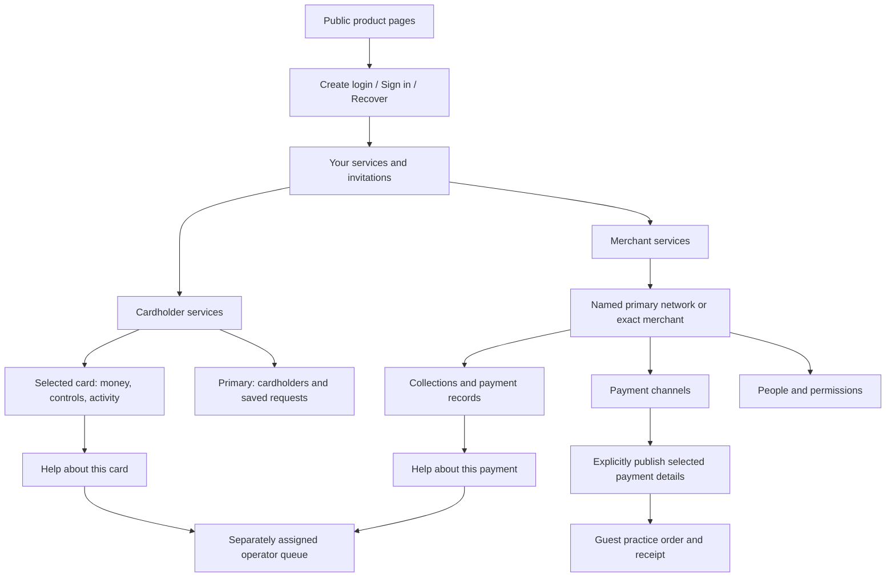
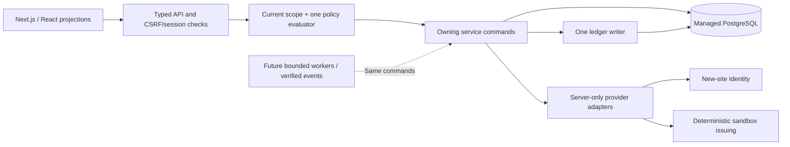
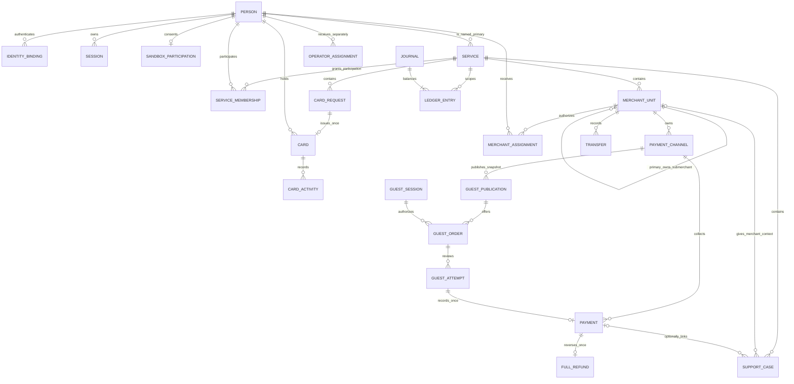

# Etail Depot — product and technical design

Version 1.3 · 11 September 2026 · D63–D65 · **Connected sandbox slices implemented; local integrated verification passed; hosted acceptance pending.**

This document consolidates the user's agreed two-service model, implemented behavior and remaining experience. The [delivery plan](../planning/DELIVERY_PLAN.md) controls implementation order; the [project prompt](../02_MASTER_BUILD_PROMPT.md) controls how subsequent work proceeds. The initial planning audit inspected tree `9f7533cc55213702e6c69ffb0c9b5e9656b03aed`; the D65 additions below describe the current implementation, not that earlier tree. [Status](../planning/STATUS.md) records exact candidate and verification evidence. This document does not certify a hosted release.

The user reviewed P1, identified missing capabilities and asked to finish the actual build. [The active build contract](ACTIVE_SANDBOX_BUILD.md) now governs implementation. [The design walkthrough companion](DESIGN_WALKTHROUGH.md) remains historical design evidence; it adds no backend capability. D65 extends the existing runtime with person/card management, durable request history, merchant activity filters/export, private Merchant support, primary freeze protection and a separately authorized guest checkout slice. The audit below distinguishes existing foundations from remaining scope; final tests and hosted acceptance remain release gates.

## 1. Product promise and scope

**Manage cards for the people you trust. Let the right people collect payments for your merchant.**

The customer chooses Cardholder services or Merchant services. A person can use either or both independently. Family, household and team explain why someone shares access; they never create account tiers. The sandbox lets people try the product using simulated money, with visible responsibility and real permission boundaries.

The connected experience covers primary cardholder, secondary cardholder, primary merchant, delegated merchant user, assigned support operator and guest payer. The broader financial and commercial scope remains required, staged below. Guest checkout now has its own public offer and private order/receipt journey; the signed-in payment preview remains separate. Card activity is not a credit billing statement. A simulated transfer is not a bank payout.

### Decisions already settled

- A named primary **person** oversees the card group; there is no physical primary-card → secondary-card ownership relationship. Cards belong to their actual holders within the service.
- A primary merchant remains responsible for submerchant sales, fees, refunds and chargebacks, with separate attribution. Each submerchant has one immutable primary. A person may operate separate units under different primaries.
- Secondary cardholders see only their own cards/data. Merchant delegates see only their granted units/data. Primary oversight never crosses into another service or network.
- Spending, card issuance, management, refunds, transfers and operator servicing are distinct permissions. Roles never substitute for product eligibility or legal responsibility.
- Exactly one active application, policy engine, card-request lifecycle, issuance owner and financial ledger. Preserve current records and tested controls; no evidence supports another total rewrite.
- American Express is the public workflow reference; Etail owns its branding, commercial rules and architecture. A 100% target is not a measured parity result.

### What success will mean

A tester can identify whose card or merchant is selected, explain the displayed money, complete a permitted task, find the persisted result after reload and recover from an interruption. Another user's private data remains inaccessible through navigation, direct URLs, APIs, exports and retries. An assigned operator can resolve an in-scope support task without customer financial authority.

Proposed usability acceptance: each of the four customer roles, the operator and a guest completes its scripted core task without facilitator navigation help on desktop and mobile. Record completion, mistaken scope, assistance, errors and recovery; any blocked core task or mistaken financial confirmation fails the gate. Establish time-on-task baselines in the first walkthrough before setting speed targets. Automated checks complement observation.

## 2. Experience architecture

### Navigation and selected context

| Area | Proposed visible navigation | Selection rule |
|---|---|---|
| Public | Cards · Accept payments · Pricing · Help · Sign in | Explain use cases before registration; accurate sandbox availability beside calls to action. |
| Your services | Cardholder services · Merchant services · Invitations | Enrollment is deliberate. Accepted secondary access opens that participation, not a new primary setup. |
| Cardholder | Overview · Cards · Activity · Cardholders · Requests | Primary sees group views. Secondary gets own-card views and relevant invitations/help; no empty management tabs. Cards separates named ownership from oversight using server-scoped search and filters. |
| Merchant | Overview · Payments · Payment channels · People · Settings | Primary chooses All my merchants or one named unit. A delegate gets exact authorized units only. |
| Shared | Help · Sign-in security · Profile | Support carries authorized resource context. Security does not depend on a financial service. |
| Operator | Assigned cases · Case detail | Separate entrance and assignments. Customer primary roles do not expose this console. |
| Guest checkout | Public request → Your order → Review → Receipt | `/checkout/{publicationId}` exposes only published payment details; `/checkout/orders/{orderId}` additionally requires the order's HttpOnly guest session. No merchant sign-in or service enrollment. |

Selected card, service, merchant, dates and filters remain in validated route/query state. Opening a row carries the same scope to detail and back. Never silently select the first database record or reset a primary's network filter to one merchant. A URL is a requested scope; the server authorizes it anew.

### Annotated layout specifications

**Cardholder overview — desktop:** service/person name and selector at top; selected-card panel with holder and safe identifier; adjacent available practice funds and direct Freeze control; recent activity immediately below; context actions for controls and help. Primary-only group summary, cardholder management and unfinished requests follow. Separate card money from group totals so a secondary never sees another holder's balance. D66's [experience contract](CARDHOLDER_EXPERIENCE_REDESIGN.md) distinguishes Your cards from Cards you manage, keeps managed cards out of implicit selection and purchasing, and gives own-card restrictions truthful server reasons. One ordinary invitation offers optional access restrictions; it never creates a separate non-purchasing card product.

**Cardholder overview — mobile:** selected holder/card, available funds and Freeze appear before decorative content. Activity follows; less frequent actions are labelled in a compact menu. The same task and state vocabulary apply on desktop and mobile. Do not expose PAN/CVV or fabricate a card number for realism.

**Merchant overview — desktop:** named primary/network or merchant selector plus date range; collections, refunds and available simulated funds with explicit definitions; a Payments table below with exact-record links. Period collections/refunds open the same scoped and date-filtered records. Available funds are explicitly as of now, independent of the activity date range; their detail shows current balance movements/availability rather than pretending to be the period sum. Payment channels and people are separate tasks. Pending, fees, reserves and bank-transfer metrics appear only when their simulated lifecycles exist.

**Merchant overview — mobile:** scope/date controls first, one compact financial summary, then a readable payment list. Selecting a row opens amount, merchant, channel, status, receipt and permitted servicing actions. Refund/transfer confirmations name the exact merchant and amount. Do not shrink a desktop table until its information is unreadable.

**Operator case:** case reason, authorized customer/resource context, timeline, current state, last action and permitted response together. A support reply never silently changes a balance or grants access. Escalation and unresolved outcomes remain visible.

**Guest checkout:** merchant and responsible primary, purpose and exact server-saved amount precede the action. Starting an order establishes a separate guest session; reviewing fixes a durable practice attempt before confirmation. A saved outcome/receipt survives reload. A declined attempt can lead to another reviewed attempt; approved/refunded orders cannot be paid again. Show order expiry separately from receipt-access expiry, and retain the same request after an uncertain response. No real payment details or delivery confirmation appear.

### Copy rules

Use “Waiting for your card,” “Payment channels,” “Payment received,” “Refund” and “Transfer practice funds” where those meanings apply. Internal IDs, grants, adapters, scope keys and ledger journals belong in diagnostics. Explain unavailable actions with a useful next step. Preserve a compact Sandbox label and honest simulation wording; removing internal language must not imply real processing.

SMS, email, invoice, bill, social, QR and website/link are presentations of a payment request. A receipt is evidence of a completed payment. Copy/share, delivered, opened and paid are different outcomes. No “sent” confirmation before delivery exists.

## 3. Role and permission design

These are product roles and target scope boundaries, not a replacement hardcoded role engine. Commands use existing explicit grants and current server policy.

| Task/data | Primary cardholder | Secondary cardholder | Primary merchant | Merchant delegate | Assigned operator |
|---|---|---|---|---|---|
| View card group | Own primary service | Own cards/activity only | No implied access | No implied access | Authorized case context only |
| Request/issue card | Issuance permission and prerequisites | Unavailable within this service | No implied access | No | No default |
| Spend using card | Own eligible card only | Own eligible card only | Separate Cardholder permission | Separate Cardholder permission | No |
| Freeze/control cards | Permitted group cards | Own permitted cards; cannot relax parent restrictions | No implied access | No | No default |
| View merchant network | No implied access | No implied access | Own primary and submerchants | Exact assigned units/records only | Authorized case context only |
| Create/use channels | Separate Merchant permission | Separate Merchant permission | Current allowed actions | Explicit actions and limits | No default |
| Refund/transfer funds | No implied access | No implied access | Named responsible primary, current permission and available funds | Unavailable in current sandbox | Unavailable |
| Invite/change/revoke | Cardholder scope and delegation ceiling | No default | Merchant scope and ceiling | Only explicit onward delegation | No customer-role administration |
| Reply/resolve support | Customer's own case actions | Customer's own case actions | Own private Merchant cases | Own private exact-unit cases | Explicit assignment and case actions |

The current sandbox restricts issuance to the named primary and merchant refunds/transfers to the responsible primary. Financial delegation would be a separate permission-expansion proposal; it is not enabled by this design. A person with both services has independent permission contexts. Accepting a merchant invitation creates a merchant assignment, not membership in the primary person's Cardholder service. Losing access blocks the next protected request and replay; historical financial effects remain attributable and reconcilable. Primary merchant oversight does not expose another requester's support conversation. Linking or reading a case's payment additionally requires current `payments.read`; assigned support uses separate service authority.

## 4. Complete journeys and failure states

| Journey | Normal path | Necessary recovery/empty states | Proof of completion |
|---|---|---|---|
| Entry | Create login → confirm email → sign in → Your services → deliberate sandbox participation → service or invitation | Existing login, unconfirmed email, expired confirmation, wrong password, reset pending, unavailable provider, timeout, stale tab | Actual authorized hosted login survives reload; logout revokes it; no automatic service/operator grants. |
| Primary cardholder | Start service → one Add card form/review for self → issued practice card → controls/activity. Optional sharing: invite → acceptance → same form for that holder | Saved request, blocked prerequisite, expired/revoked invitation, stale edit, uncertain submit | One request creates one card/funding effect; primary manages but cannot purchase as secondary. |
| Secondary cardholder | Accept intended invitation → named primary/group → own card → practice purchase → activity/help | **Accepted but no card:** “Your primary is preparing your card”; declined/expired invitation; frozen card; insufficient funds; revoked permission | Own result persists; sibling/primary-private records are inaccessible. Independent primary enrollment is optional, not the default empty state. |
| Primary merchant | Start service → test setup → own channel → practice payment → receipt. Optional delegation: submerchant → collector invitation; permitted refund/transfer remain primary tasks | Setup incomplete, no payments, paused channel/unit, insufficient funds, duplicate click, changed permission | Choose last week's network collections → exact included payments → back with same filters; effects reconcile once. |
| Merchant delegate | Accept exact-unit invitation → assigned merchant → permitted channel → payment result → receipt/help | No channel permission, expired/used channel, grant revoked, awaiting primary setup | No siblings or another primary; collection rights cannot become refund/payout rights silently. |
| Assigned operator | Resource-linked case → assigned queue → permitted context → reply → resolve as supported | No assignment, customer access changed, unavailable context, stale response | Attributed history/resolution; no impersonation or direct balance edit. Cardholder and Merchant cases use the same lifecycle. |
| Guest payer (D65 implementation) | Published public offer → private order → exact amount review → practice payment → revisitable receipt | No publication, revoked/expired/changed offer, declined attempt, lost response, one-time use, foreign order | Guest cookie authorizes only that browser's orders. One approved payment per order; merchant records and ledger reconcile through the sole payment writer. |

Every screen defines loading, empty, ready, saving, success, validation error, denied, stale version and unknown-result states. Financial forms preserve the submitted operation identity after timeout. Recheck status and offer safe recovery; never start a second effect because the browser did not receive the first response.

## 5. Current architecture and build-versus-buy decisions

Retain the installed modular monolith. This is a maintenance and correctness choice based on current source, not a claim that its vendors are universally best.

| Concern | Current decision | Reconsider only when |
|---|---|---|
| App/UI | Next.js App Router, React, TypeScript; existing forms/server projections | A measured limitation cannot be addressed in the current architecture. |
| Database | Managed Netlify PostgreSQL, Drizzle schema/SQL guards and one migration lineage | A demonstrated transaction, deployment or operational requirement cannot be met. |
| Authentication | Server-side Netlify Identity adapter and opaque HttpOnly application sessions | Hosted lifecycle/configuration diagnosis shows an unmet requirement. First prove signup, confirmation, login, recovery and session transport. |
| Issuing/acquiring | Custom domain rules; adapters isolate simulation and future providers | Approved provider contract/capability evidence exists. An SDK does not supply responsibility rules. |
| Analytics | No new analytics service in this task | Public funnel goals, privacy and volume justify it. Marketing analytics cannot replace payment records. |
| Email/channel delivery | Identity delivery boundary retained; outbound merchant delivery is future | Sender, consent, abuse controls, per-channel semantics and environment authorization are defined. |
| Workers/files | Add bounded processing/private storage only for reviewed slices | A durable lifecycle or evidence document needs it. An outbox table is not a working runner. |
| Open source | Audited libraries within existing owners | Upstream/license/maintenance/compatibility evidence and a concrete gap justify a dependency. No whole SaaS/commerce fork. |

Installed pins are recorded in `package.json`/`pnpm-lock.yaml`, including Node 24.19.0, Next 16.3.4, React 19.2.8 and TypeScript 6.0.3. These are source observations, not a fresh compatibility certification. No dependency changed for this design.

### Command ownership and API boundary

| Owner | Responsibility |
|---|---|
| `identity` | Provider verification, throttling/reset uncertainty and opaque sessions |
| `services` | Identity binding, explicit Cardholder/primary-Merchant enrollment and queries |
| `access` + `policy` | Typed scope loading, invitation/grant lifecycle, current deny-by-default authority |
| `workspace` | Saved card requests, card submission, controls, practice purchases and projections |
| `acquiring` | Merchant units/business details/channels; operations service owns test setup, payment, full refund and transfer. Guest publication/order/attempt commands reuse that payment persistence owner. |
| `ledger` | Sole immutable balanced journal writer and financial positions |
| `cases` + `operations` | Customer cases and independently assigned operator responses |
| `reports` / `membership` | Authorized activity reports/exports; source-based estimates respectively |

One `/api/v1/` surface. UI sends resource IDs, validated input, expected versions and command identity. Server loads relationships, checks current permission/prerequisites inside the transaction, commits business records plus ledger/receipt, and returns an authorized projection. Validation, conflict, denied, pending and unavailable outcomes require explicit recovery. Capability responses aid rendering; they are not bearer permissions.

Guest publication/revocation remains under authenticated `/api/v1/merchants/{merchantId}/channels/{channelId}/publication`. The `/api/v1/guest/` routes use a separate HttpOnly order-only session and same-origin write checks, with no person/service grants. Public locators are intentionally shareable; order IDs alone grant no receipt access. Preparing an attempt fixes its command ID and approved/declined practice result; confirming that exact attempt invokes the common payment owner. After uncertainty, retrieve the same order or replay the same attempt, never silently create another financial effect.

## 6. Database model

This conceptual map simplifies implemented relationship names. Executable authority is [the schema](../src/platform/database/schema.ts), module schemas, migrations and SQL constraints. Identity/session is not service membership. No migration is proposed merely to rename customer-facing text.

Constraints narrow this diagram: one primary Cardholder service per person, with secondary participation elsewhere. Merchant service membership belongs to its primary; others use merchant assignments. One primary merchant unit per Merchant service; submerchants are direct children in the same service, never recursive networks. Cases have a service-kind discriminator: Cardholder creator membership is retained, while Merchant cases use exact unit/service and optional payment/unit/service foreign keys without creating collector membership. Guest orders have immutable publication, unit, service, channel revision and amount snapshots. Guest sessions never become people or service members.

### Invariants to preserve

- Service kind/primary, merchant ancestry/service and channel creator provenance are immutable. Composite keys constrain cross-service relationships.
- Every card has one issuance request and a same-service holder whose accepted authority is checked at issuance/use; one request issues at most one card under retries/concurrency. Revocation blocks subsequent use but preserves the historical card and records.
- One-time channels have at most one approved use; a full refund separately matches the original principal. Partial refunds require a reviewed lifecycle, not an ad hoc guard relaxation.
- One-time use is shared across signed-in and guest payments. Each guest order has at most one approval; a refunded order cannot be charged again. Publication binds the publisher's current authority and channel/setup revisions. Revoked or changed publication stops new acceptance while an already recorded receipt remains accessible to its unexpired guest session.
- Current money is integer USD minor units; wire values are strings. Future currency support preserves per-currency balancing without summing currencies silently.
- Journals/entries commit together, balance and remain immutable. Financial records match scoped journal effects; current sandbox commands cannot spend or transfer more than available. Future verified late clearing or chargebacks must still reconcile truthfully, including deficits; do not discard real established events to preserve a nonnegative display. The future financial model must define deficit/suspense handling before those events are enabled.
- Current authority is rechecked before reads, writes, exports and protected retries. Revoked grants cannot revive through descendants or replacement invitations.
- An enum does not prove a command, UI, worker or provider decision exists.

### Current states versus future states

| Entity | Implemented transitions | Not established |
|---|---|---|
| Card request | DRAFT/BLOCKED → ISSUED or CANCELED; same resumable request | Asynchronous submitted/processing/reconciliation; physical fulfillment |
| Card | ACTIVE ↔ FROZEN; primary and holder restrictions are explicit. Secondary cannot remove a primary restriction. Older freezes require primary review. | Replacement, closure and late clearing lifecycle |
| Merchant application | DRAFT → PENDING_LOCAL_REVIEW | Real approval, KYB/KYC or MID issuance |
| Merchant unit | ACTIVE ↔ PAUSED | Customer closure command; live network status |
| Channel | Content DRAFT/CANCELED; separate activation ACTIVE/DISABLED; derived used/expired/not-ready; explicit guest publication and revocation | External message delivery and delivery status |
| Guest order/attempt | Saved order → durable review → approved/declined practice result; declined may be reviewed again; refund reflected in receipt; derived unavailable state | Live checkout, asynchronous capture/provider processing, external payer identity or notification delivery |
| Support case | Shared Cardholder/Merchant OPEN conversation → WITHDRAWN or operator RESOLVED; replies identify CUSTOMER/SUPPORT next actor | Payment disputes, financial adjustments or a separate escalation workflow |
| Payment | APPROVED/DECLINED; refunded derived from separate full refund | Pending capture, partial refund, dispute, reserve, settlement/reconciliation |
| Transfer | Synchronous completed practice effect | Pending/failed bank transfer |
| Invitation | PENDING → ACCEPTED/DECLINED/REVOKED/EXPIRED | External invitation delivery proof |

Current financial commands are synchronous PostgreSQL transactions with business uniqueness and retry receipts. An event outbox exists, but delivery leases, attempts, a bounded worker and payment event inbox are not implemented. Do not depict a realistic asynchronous payment network until those paths are designed and exercised.

### Active and remaining additions

| Slice | Data/API design required first |
|---|---|
| Merchant support — implemented, local verification passed | Typed merchant/payment case reference, requester visibility, operator assignment, safe financial context and resolution. Additive migration preserves Cardholder cases; no collector service-membership grant. |
| Guest payments — implemented, local verification passed | Public offer; separate 24-hour HttpOnly guest session; immutable order and reviewed attempts; payment readiness limited to 30 minutes or earlier offer/session expiry; authoritative receipt/refund access until session expiry. Explicit publish/revoke and current authority checks; no credentials in URLs or private merchant projections. Signed-in preview remains separate. |
| Delivery | Per-channel attempts, recipient safeguards, status independent of payment, replay/expiry and audit. Copying a link is not delivery evidence. |
| Asynchronous providers | Stable business operation, transactional outbox, verified inbox, bounded leases/retries, reconciliation and unknown-result recovery; adapter/event tests. |
| Payment exceptions | Refund allocations, disputes, settlement/reserve/transfer states and immutable journal effects; concurrency/reversal policy before writes. |
| Card/commercial scope | Replacement/closure, responsible funding/facility, billing/calendar/reward attribution and source costs; D14–D17 resolved for affected money. |

Future migrations are additive or rehearsed transformations within the current model. Compare records, scope, IDs, balances and permissions before/after; preserve recovery. Never reset hosted or preview data to make a demonstration appear complete.

## 7. Evidence, gaps and operating readiness

| Area | Current evidence | Remaining acceptance |
|---|---|---|
| Email | Implemented lifecycle/local transport harness and hosted readiness; user confirms hosted sign-in reaches Your services | Current-release confirmation/recovery/reload/logout and authorized service-task acceptance remains separate; recurring provider configuration drift cause remains unknown. |
| Cardholder | Enrollment; per-person cards/access/invitation state/history; searchable paginated saved requests; issuance/purchases/reports/private cases; separate primary and holder freeze ownership | Integrated desktop/mobile/privacy/retry checks and human acceptance in progress; later billing/replacement/provider scope remains. |
| Merchant | Units/delegates; network/unit period activity, matching export and return links; seven presentations; signed-in payment/full refund/transfer; private merchant/payment support; published guest orders/review/receipt | Integrated verification and human acceptance in progress; external delivery, asynchronous processing and financial exceptions remain. |
| Operations | Assigned Cardholder and Merchant case replies/resolution, exact related payment/refund dates and amounts, customer next action | Integrated handoff verification in progress; broader financial exception operations remain. No automatic staff access/impersonation. |
| Commercial | Source contracts and membership estimate | Membership billing, reward posting, actual source costs and open financial decisions. |
| Release | Candidate source/unit/contracts/lint/architecture and production build checks passed; focused guest/domain checks exist | Complete integrated database/browser verification is in progress. Each release still needs exact revision/schema, packaging, hosted persistence/isolation/recovery and visual acceptance evidence. |

Define configuration ownership and an operator runbook: expected Identity flags/origin, drift detection, symptom-to-check mapping, request correlation without credentials, safe session recovery, simulator health and escalation. Read-only readiness checks identify dependencies; they must not silently repair policy or reset users. Operators receive only the context necessary for assigned tasks.

## 8. Open decisions and retained economics

The source commercial contract remains binding: Select/Premier pricing, actual provider/brand-cost meaning, base cashback and one shared Premier annual cap. Services are not plans. The original annual example remains a model fixture, not customer savings evidence. Retain consumer statement-based pay-in-full and commercial daily full-repayment as distinct future policies; neither is a revolving balance or today’s practice allocation. Collateral, obligations, holds, reserves, settled available funds and pledged funds retain distinct meanings; money cannot simultaneously back spending and be paid out. Supervised children/teens are guardian-funded, never independent borrowers. These retained outcomes do not claim that the current adult sandbox implements supervised eligibility or credit facilities.

D14 rounding, D15 membership-year/calendar boundaries, D16 sponsoring-membership attribution and D17 supervised/backed funding remain open for affected writes. Map them to services, people and responsible funding relationships. Primary/submerchant responsibility and multi-primary participation are already decided; do not ask again.

Live eligibility/legal/retention requirements, actual provider MID/routing/settlement support and sender/DNS changes retain separate gates. They do not block designing/testing the authorized sandbox. The [delivery plan](../planning/DELIVERY_PLAN.md) keeps full scope visible without calling unimplemented work completed.

## 9. Source map

Current source audit: [services](../src/modules/services/service.ts), [policy](../src/modules/policy/evaluate.ts), [card commands](../src/modules/workspace/service.ts), [cardholder management](../src/modules/access/service.ts), [merchant activity](../src/modules/acquiring/activity-service.ts), [merchant operations](../src/modules/acquiring/operations-service.ts), [guest orders](../src/modules/acquiring/guest-service.ts), [guest contracts](../src/modules/acquiring/guest-contracts.ts), [ledger guards](../src/modules/ledger/constraints.sql), [cases](../src/modules/cases/service.ts), [operator scope](../src/modules/operations/service.ts), [database transport](../src/platform/database/client.ts).

Public experience evidence retained from [selected-card study](research/amex/CARDHOLDER_DASHBOARD_ROLES.md), [merchant role study](research/amex/MERCHANT_DASHBOARD_ROLES.md) and [experience correction](AMEX_EXPERIENCE_CORRECTION.md). These studies have market/role/inspection limits; no new private Amex access or parity measurement is asserted. The user's new video and our planning response are in [the video review](research/VIDEO_PLANNING_REVIEW.md).
