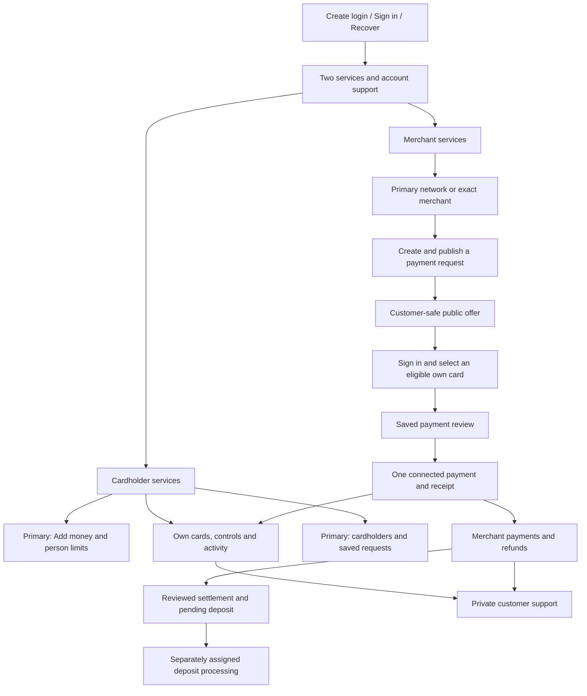
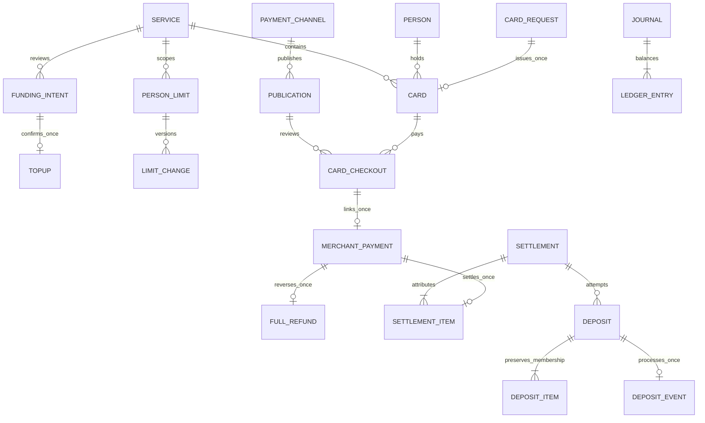

# Etail Depot — product and technical design

> **D76 active override — 12 September 2026:** [Network cards and resource invitations](NETWORK_CARDS_AND_RESOURCE_INVITATIONS.md) governs Visa product intent, create-card-first recipient assignment, exact terminal invitations and public external-card checkout. It supersedes the internal-Etail-only payment path and person-first/member-code invitation requirements. D73 separate balances, total card allowances and owner/holder/terminal isolation remain in force. Historical text below is dated context.

> **D73 active override — 12 September 2026:** [Owner, cards and terminals](OWNER_CARDS_TERMINALS_DESIGN.md) governs the current rebuild. The user explicitly chose **separate card and merchant money** and **per-card total allowances with no monthly reset**. Owners manage cards and one merchant’s flat terminals; invited holders/users have only their own resource access. Primary/secondary customer tiers, per-person monthly limits, submerchant responsibility and shared card/merchant balances are superseded. The text below retains the dated D69–D72 baseline for migration and review history; it does not override D73.

Version 2.0 · 12 September 2026 · D69 · **Prepaid replacement locally verified; hosted release remains separate.** See [D69 evidence](PREPAID_REBUILD_EVIDENCE.md).

[FRESH_PREPAID_REBUILD.md](FRESH_PREPAID_REBUILD.md) is the accepted money/experience replacement contract. This document consolidates its active architecture with the retained two-service permissions. [The project prompt](../02_MASTER_BUILD_PROMPT.md) governs implementation and [the delivery plan](../planning/DELIVERY_PLAN.md) governs sequence. [Status](../planning/STATUS.md) distinguishes this candidate from the dated D65–D68 evidence. Earlier allocation and guest-simulator journeys are historical, not an alternate active product.

## 1. Product promise and boundaries

**Fund cards for people you trust. Let the right people collect payments for your merchant.**

A customer chooses Cardholder services or Merchant services; either can exist independently. Family and team describe use cases, not account types. The named primary Cardholder funds a shared prepaid group; each actual holder has an individual monthly limit across their cards. A primary merchant is responsible for its submerchants, with separately attributed records. Delegates operate only within exact authorized units, including distinct units under multiple primaries.

Identity, service participation, spending/issuance, Merchant assignments and operator access remain separate. Accepting an invitation creates no card or money. A primary's oversight does not allow spending as another holder. Merchant delegates receive no Cardholder service membership. Minors remain guardian-funded; the current adult sandbox does not implement independent child borrowing or supervised eligibility by implication.

The active cards are prepaid. Earlier charge-card repayment, collateral/facility and billing designs remain separately scoped source requirements if resumed; they do not change this product's money model. Amex informs public workflows and screen hierarchy, not Etail economics or private architecture. The 100% comparison target is not a current parity claim.

## 2. Customer experience

| Area | Active tasks and scope |
|---|---|
| Your services | Cardholder services, Merchant services and account support. No global Invitations product or required acceptance step. |
| Cardholder | Home, Cards, Activity, primary Cardholders/Requests/Add money, and Account services. Selected-card filters distinguish own cards from managed cards. |
| Merchant overview | Named primary/network or exact-unit scope, period payments/refunds/completed deposits, current Funds & deposits, and Merchants & people. |
| Named merchant | Payments, Collect payments, People, Account services and Help. Payments includes transactions, refunds and deposits. |
| Shared access | Optional service-related invitation review at `/shared-access`; explicit accept/decline remains, without reinstating a global invitation menu. |
| Customer checkout | Public published request → sign in → eligible own card → saved review → payment receipt. No guest payment simulator or outcome picker. |
| Operator | Independently assigned support cases; separately permitted deposit processing. Customer roles do not expose either by implication. |

Keep the selected service/card/merchant, relevant date/filter and exact record in validated URL state. A link requests scope; the server authorizes it again. Do not choose an unrelated first record after a denied selection. Funding and payment reviews have saved IDs in the URL before confirmation. Other mounted-owner operations retain their current retry and document their reload/back limits.

Cards show whose card is selected, safe identifying information, available spending and current controls together. Secondary views omit group totals, funding history and other people. Managed cards show oversight, never an action to spend as the holder. Creating a card asks for holder, name and format; there is no starting-balance field or dashboard “Try purchase” form. Add money and person limits are separate tasks.

Merchant records lead to exact payment/refund/deposit details and back to the same merchant/date context. Current balance cards are independent of period filters. Deposits disclose their included payments, requested amount, processing state and retained history; they are not renamed instant transfers. At narrow widths, money, status and next action precede secondary navigation without shrinking records into unreadable tables.

Use Etail branding and plain terms: Add money, Available to spend, Customer payment link, Payments, Refunds, Deposits and Sandbox bank. Seven channel presentations remain SMS/text, email, invoice, bill, social, QR and website/link. Publishing/copying, delivery and payment are different outcomes. A receipt follows saved payment success. Sandbox disclosure remains visible without suggesting real rails, verification or Amex integration.

## 3. Roles, permissions and recovery

| Task/data | Primary Cardholder | Secondary Cardholder | Primary Merchant | Merchant delegate | Assigned operator |
|---|---|---|---|---|---|
| Group funding/history and person limits | Named primary, current specific grants | No | No implied access | No implied access | No default |
| Request/issue card | Existing primary issuance permission and prerequisites | No issuance authority in this service | No implied access | No | No default |
| Spend | Eligible own card only | Eligible own card only | Separate Cardholder context | Separate Cardholder context | No default |
| View/control cards | Permitted group oversight | Own permitted cards; cannot lift a primary freeze | No implied access | No implied access | Authorized case context only |
| Merchant records/network | Separate Merchant context | Separate Merchant context | Own primary and submerchants | Exact granted units and records | Assigned context only |
| Channel creation/publication | Separate Merchant grants | Separate Merchant grants | Current allowed actions | Explicit channel/read/share authority | No default |
| Full refund / request deposit | No implied access | No implied access | Responsible primary and current financial permission | Unavailable in current sandbox | No customer financial authority |
| Process deposit outcome | No | No | No | No | Explicit `canProcessDeposits` assignment; support-only assignment is insufficient |
| Invite/revoke | Existing Cardholder ceiling | No default | Exact Merchant scope and ceiling | Explicit onward-delegation ceiling only | No customer grants |
| Support | Own private case | Own private case | Own private Merchant case | Own private exact-unit case | Explicit assignment and permitted response |

Commands use the one policy evaluator, never a client role string. Every read, write, export and protected replay checks current accepted scope. Secondary data does not widen through extra cards, invitation replacement or multiple primaries. Merchant primary oversight does not expose another requester's private support conversation. Reading linked payment context still needs the appropriate current payment or operator scope.

Every workflow covers empty, waiting, loading, saving, success, denied, stale, expired and unknown-result states. Acceptance without a card remains a clear waiting state. Access invitations never issue cards automatically. Merchant access changes use the existing revoke/new-invitation lifecycle; no invented edit/extend action is implied.

After a timeout or malformed success shape, retain the immutable command and payload. A later 403/404 is not proof the first request did not commit. Hide unavailable private context, keep the original recovery action visible, and clear the unavailable state only after authoritative success. A saved spending-limit retry remains a limit PUT, not a funding request. Explicit safe exit, where implemented, neither cancels nor confirms an unknown operation. Do not widen grants to recover a result.

## 4. Prepaid financial contract

| Meaning | Owning record/effect |
|---|---|
| Group money | Service-scoped `GROUP_AVAILABLE`, with no card/merchant ID; exact nonnegative USD minor units. |
| Add money | Durable funding intent and immutable top-up receipt; `GROUP_FUNDING` transfers from `PRACTICE_SOURCE` into the group. |
| Person limit | `(serviceId, personId)` versioned limit and immutable before/after history; no money posting or reservation. |
| Monthly usage | Gross approved Cardholder purchase principal across all of that person's cards in the group and the authoritative UTC calendar month. |
| Available spending | Minimum of group funds and remaining monthly allowance. Do not sum card/person allowances as balances. |
| Card issuance | One card from one canonical saved request; zero journal and zero implicit funding/limit change. |
| Connected payment | Saved payer-owned review; one Cardholder debit/activity and linked Merchant payment/credit in the same transaction, using paired existing ledger journals. |
| Full refund | One Merchant refund plus original-group credit and card-attributed credit activity, committed atomically. Gross monthly allowance is not restored. |

Lowering a limit below already-spent money leaves zero remaining allowance. New cards, changed limits, refunds and revoked/reaccepted access do not erase usage. The calendar calculation requires no monthly reset job. Secondary spendability can reveal a bound on shared funds when funding is lower; it must not disclose group amounts or funding history directly.

Funding, limit changes and purchases serialize on the service workspace lock. Connected payment/refund commands acquire participating service locks in sorted order before protected resource locks. Current authorization, frozen state, limit and actual funding are checked inside the transaction; a late failure rolls back both services' effects. One-time publication/channel use is enforced across all relevant existing records. Public locators grant no card or merchant authority; only the saved payer can read/replay their protected review.

## 5. Settlement, deposit and refund contract

An initial deposit review identifies all currently eligible, approved, unrefunded and unsettled post-cutover payments for one merchant. Its token binds membership and principal. A changed candidate set rejects the review rather than accepting a stale amount. The command persists settlement membership and moves Merchant available money to settled money, then reserves the exact deposit amount as PENDING. No arbitrary amount field or immediate bank completion remains.

| Customer balance | Ledger meaning |
|---|---|
| Awaiting settlement | `MERCHANT_AVAILABLE`: new eligible collections, less applicable refunds. |
| Processing | `MERCHANT_PAYOUT_PENDING`: money reserved by pending deposit requests. |
| Returned deposits | `MERCHANT_SETTLED`: funds returned after failed processing and available for permitted refund/new reviewed deposit. |
| Sandbox bank balance | `PAYOUT_CLEARING`: completed deposits, less later refunds. No real bank account is connected. |

The separate operator command appends one immutable COMPLETED or FAILED event. Completion moves reserved money to Sandbox bank; failure returns it to settled funds. Duplicate delivery/retry has one effect, while conflicting command/outcome reuse is denied. Support-only operators and Merchant customers cannot process it.

A new attempt after failure reviews the remaining unrefunded items from the original settlement. It excludes later collections, preserves each earlier deposit's exact items and requires a fresh token if refunds or processing history changed. A pending/completed attempt or an empty remaining batch cannot be retried as new money.

Refunds before settlement use Merchant available funds; after all failed attempts they use returned settled funds; after completion they use Sandbox bank funds. Any pending deposit for that batch blocks refund. All paths still credit the original Cardholder group and preserve primary liability. Partial refunds, chargebacks, reserves and real processor settlement remain separate future lifecycles.

## 6. Ownership and database integrity

Retain the installed Next.js/React/TypeScript modular monolith, managed PostgreSQL/Drizzle migrations, lockfile, Netlify adapter, server-side Identity adapter and opaque HttpOnly application sessions. Exact versions are source-controlled in the package/lockfile, not repeated as a compatibility assertion here.

| Owner | Responsibility |
|---|---|
| `identity` / `services` | Verified identity, sessions, deliberate service enrollment and directory. |
| `access` / `policy` | Canonical scope, invitations, grants and current authority. |
| `workspace` | Saved card requests/issuance, controls, funding intents/top-ups, person limits and canonical purchase effects. |
| `acquiring` | Merchant setup/units/channels/publication, connected checkout orchestration, payment/refund, settlement/deposit and separately authorized outcome processing. |
| `ledger` | Sole balanced immutable journal writer and exact positions. |
| `cases` / `operations` | Shared private support lifecycle and independently assigned servicing context. |
| `reports` / `membership` | Scoped activity/exports and source-based estimates; estimates are not billing or rewards postings. |

API routes validate/authenticate and call these owners. React neither calculates authoritative balances nor posts journals. Canonical customer payment entry is `/api/v1/checkout/{publicationId}/card` and its saved review; funding has `/funds/intents` and its saved confirmation. Retired guest mutation and merchant `test-payments` routes return 404. Historical schema/migration records retained for integrity are not alternative customer entry points.

The diagram is conceptual; executable module schemas, migrations and SQL guards govern exact fields. Composite scope keys prevent cross-service/card/merchant links. Immutable posted journals and business provenance commit together; no orphan purchase/refund/deposit journal can stand in for a missing business record. Card/service primary identity, Merchant ancestry and channel provenance stay immutable. Command identity does not bypass current authority.

## 7. Local replacement and verification

D69 retires both previous fixed local generations by exact catalog identity to `etail_depot_next_services_preview_retired_d69` and `etail_depot_next_services_test_retired_d69`, preserving their OIDs/records with `ALLOW_CONNECTIONS=false`. Fresh databases use the original fixed active names and generation `fresh-services-d69`. The retained older databases and hosted Database/Identity remain outside application/reset scope.

Additive migrations preserve deployed history. The new empty seed accepts only verified migration receipts and the single immutable prepaid cutover configuration row before initialization. Canonical seed commands explicitly fund the group, set person limits, issue unfunded cards, pay published requests, refund and process a reviewed deposit. No old fixture rows or fabricated journal provenance are restored. Completed seed preparation never rewrites user edits; preview startup never migrates/seeds. [Tools instructions](../tools/README.md) govern exact targets, private preservation receipts and recovery.

Acceptance follows sign-in → group → Add money → limit → card → published checkout → both exact receipts → original-group refund → settlement/deposit → explicit operator reconciliation. Exercise own/managed visibility, separate services, primary/delegate scope, pending/failed outcomes, stale reviews, concurrent spend/limit/refund/deposit races, valid-JSON malformed success responses and retained retries after access loss. Preserve desktop/mobile/keyboard/axe/reflow evidence and operator handoffs.

D68's local results and older hosted session/revision remain dated evidence. D69 final counts, exact candidate/tree, package, visual results, deployment and hosted task acceptance must be recorded from actual runs. No release or parity result is inferred here.

## 8. Remaining scope and source map

External SMS/email delivery, durable automatic provider processing, partial refunds, disputes/reserves, actual card/bank/MID rails, card replacement/closure, broader notification/file/partner operations and billing/rewards remain separate work. A support conversation is not a dispute, and a persisted operator outcome is not live processor reconciliation.

Commercial source rules retain costs/fees, Select/Premier membership, one shared annual bonus cap, refunds/reversals and provenance. D69 prepaid funding does not resolve D14 rounding, D15 membership-year rules, D16 sponsor attribution or D17 broader supervised/facility choices. The active UTC monthly spending limit is a separate explicit sandbox rule. Preserve workbook bytes/extraction and never turn an unknown cost into zero.

Source owners: [Cardholder commands](../src/modules/workspace/service.ts), [funding schema](../src/modules/workspace/funding-schema.ts), [connected checkout](../src/modules/acquiring/card-checkout-service.ts), [Merchant operations](../src/modules/acquiring/operations-service.ts), [settlement schema](../src/modules/acquiring/settlement-schema.ts), [policy](../src/modules/policy/evaluate.ts), [ledger](../src/modules/ledger/service.ts), [private cases](../src/modules/cases/service.ts) and [operator scope](../src/modules/operations/service.ts). D69 research links/inspection limits are in [the prepaid contract](FRESH_PREPAID_REBUILD.md); prior Amex studies remain in [the research archive](research/amex/README.md).
