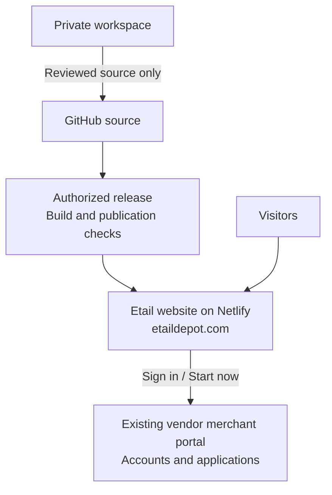

# Repository guide

This map describes the current local candidate, based on GitHub `main` commit `b62ff7e5e033313a77eb53e6a1110e6d427e946c`. The selective archive trim on 9 November 2026 is included below and has not yet been published. See [current work context](CURRENT_WORK_CONTEXT.md) for task and release status.

## How the project is categorized

We use **three working categories**. These are responsibilities and publication boundaries, not three new folders, repositories or teams.

| Category | What belongs here | Main locations | Publication |
| --- | --- | --- | --- |
| **1. Website source** | Business pages and the technical code that presents them | `src/`, `public/` | Source is in public GitHub. The build publishes compiled pages/assets; approved `public/` files are directly accessible. |
| **2. Engineering support** | Contributor workflow, shared tools, tests, hosting, configuration and preserved history | `.github/`, `tools/`, `tests/`, `netlify/`, `patches/`, `docs/`, `archive/`, root configuration | Public GitHub source. These are not customer pages or raw website downloads. Approved Netlify runtime files are separately packaged to run at the hosting boundary. |
| **3. Private workspace** | Supplied material and generated working files; credentials in approved private storage | External `local-work/input/` and `local-work/output/`; existing ignored tool state | Neither GitHub nor the public website. These are not tracked folders in the tree below. |

Within Website source, **[BUSINESS]** identifies who owns the content and customer purpose; **[TECHNICAL]** identifies reusable implementation and URL wiring. A business folder still contains code, styles and artwork. Shared technical code is part of the website, not a fourth category or a new backend.

The public **Developers** section is a business feature for customers. Managing developers who work on this project belongs in `CONTRIBUTING.md`, `.github/` and `docs/`. The external merchant portal is outside this repository; sign in and registration remain approved vendor links.

### How private work becomes the public website

Publish reviewed source and approved assets. Keep credentials, original captures and vendor test records private.



The [developer workflow](../CONTRIBUTING.md#how-several-developers-work-together) covers branches, PR checks and approval before release. GitHub is public; only the reviewed website package is served on Netlify. Development files stay off the website.

**Sign in** and **Start now** open the fixed vendor Welcome page without referrers or forwarded input. The vendor handles accounts and applications. This repository remains the public marketing website.

### Repository at a glance

```text
etail-depot-next/
├── src/                         WEBSITE SOURCE
│   ├── features/                [BUSINESS] Content, artwork and UI by business area
│   │   ├── home/
│   │   ├── services/
│   │   ├── use-cases/
│   │   ├── developers/          Public information for customers
│   │   ├── resources/
│   │   ├── company/
│   │   └── pricing/
│   ├── app/                     [TECHNICAL] URL entry points and root layout
│   └── shared/                  [TECHNICAL] Common UI, brand, styles and facts
├── public/                      WEBSITE SOURCE: approved public assets
├── .github/                     ENGINEERING: tasks, pull requests and CI
├── tools/                       ENGINEERING: shared build and verification tools
├── tests/                       ENGINEERING: automated checks
├── netlify/                     ENGINEERING: approved hosting boundary
├── patches/                     ENGINEERING: reviewed dependency fixes
├── docs/                        ENGINEERING: current project instructions
├── archive/                     ENGINEERING HISTORY: preserved, inactive records
├── README.md                    Project introduction and quick start
├── CONTRIBUTING.md              Human and AI contributor workflow
├── AGENTS.md                    Instructions AI contributors must follow
├── project-targets.json         Exact permitted repository and hosting targets
└── [root configuration files]   Build, dependency, test and hosting settings
```

`[root configuration files]` is an explanatory label, not a directory. Their exact names are listed below. **Repository-only does not mean confidential:** this GitHub repository and its archive are public. The [file publication policy](FILE_PUBLICATION_POLICY.md) governs what can be committed and served.

Jump to the [business features](#business-features), [route folders](#route-folders), [shared website-code folders](#shared-website-code), [public assets](#public-assets), [engineering folders](#engineering-support), [root files](#root-files) or [private workspace](#private-workspace).

## Website source

### Business features

All current feature directories are shown. Individual files are omitted from the tree so the ownership remains readable.

```text
src/features/  [BUSINESS] Content and UI owned by each business area
├── company/  Company information, contact, trust and legal content
│   ├── about/
│   ├── contact/
│   ├── legal/
│   │   ├── components/  Shared legal document renderer
│   │   ├── legal-center/  Legal directory page
│   │   ├── website-privacy/  Website Privacy page
│   │   └── website-terms/  Website Terms page
│   └── trust/
├── developers/  Public developer information; Etail API products unavailable
│   └── guidance/  Current guidance reused inside the listed developer pages
├── home/  Company introduction and customer entry points
├── pricing/  Approved offer and pricing presentation
├── resources/  Merchant setup, integration guides, Help and references
│   ├── components/  Components reused within Resources
│   ├── guides/
│   ├── help/
│   ├── integrations/
│   │   ├── shopify/
│   │   │   └── assets/  Feature-owned images
│   │   │       └── previews/  Reviewed small image previews
│   │   └── woocommerce/
│   │       └── assets/  Feature-owned images
│   │           └── previews/  Reviewed small image previews
│   ├── merchant-account-setup/
│   │   └── assets/  Feature-owned images
│   └── references/
│       ├── components/  Reference reading components
│       ├── iso-20022/
│       │   └── data/  Approved reference data and provenance
│       └── iso-8583/
│           └── data/  Approved reference data and provenance
├── services/  What the company offers
│   ├── ach-payments/
│   ├── card-services/
│   ├── components/  Artwork reused within Services
│   ├── disputes/
│   ├── merchant-onboarding/
│   ├── overview/  Merchant services overview
│   ├── payment-methods/
│   ├── payouts/
│   ├── reconciliation/
│   ├── refunds/
│   ├── service-model/  Payment facilitator explanation
│   └── shared/  Layout and types reused within Services
└── use-cases/  Who the services are for and why
    ├── online-businesses/
    ├── software-platforms/  Platforms and industry-specific sections
    │   ├── partnerships/
    │   └── payment-models/
    └── switch-merchant-services/
```

| Business area | Customer purpose |
| --- | --- |
| Home | Introduce the company and help visitors choose a path. |
| Services | Explain the services the company offers. |
| Use cases | Explain who uses those services and why. |
| Developers | Present public integration information and the planned Etail developer products, with their current availability clearly stated. |
| Resources | Help merchants with account setup, integration guides, Help and payment code references. |
| Company | Explain the company, contact options, trust and legal provisions. |
| Pricing | Present the approved offer and its conditions. |

These folders represent current implemented content. There are no Magento, custom-website integration or marketing-article feature folders yet. Add a new feature only when its scope is approved; a future navigation idea is not an implemented service.

A feature keeps its content and visual implementation together. Existing file conventions include `content.ts` for content, `metadata.ts` for page metadata, `page-content.tsx` for page composition, `artwork.tsx` or a descriptive component name for artwork, and `assets/` for images. Use the conventions that fit the feature. Do not add empty folders or duplicate wrapper files merely to make every feature identical.

The nine merchant legal document routes reuse approved legal content and a renderer. The Developers pages reuse their feature's guidance and presentation. Thousands of reference URLs are generated from reviewed data. None needs one duplicated feature folder per public address.

### Route folders

`src/app/` connects the public address to its owning feature. The existing directory names below reflect the current category URLs. Route directories contain `page.tsx` entry points where a page exists; their individual files are omitted, while root entry files are shown.

```text
src/app/  [TECHNICAL] URL entry points that compose business features
├── company/
│   ├── about/
│   ├── contact/
│   ├── legal/
│   │   ├── acceptable-use/
│   │   ├── acquirer-disclosure/
│   │   ├── data-processing/
│   │   ├── fees/
│   │   ├── merchant-privacy/
│   │   ├── merchant-services/
│   │   ├── payouts-and-reserves/
│   │   ├── security-policy/
│   │   └── software-platforms/
│   ├── privacy/
│   ├── security/
│   └── terms/
├── developers/
│   ├── api-reference/
│   ├── api-status/
│   ├── changelog/
│   ├── developer-tools/
│   ├── getting-started/
│   ├── sdks/
│   ├── testing/
│   └── webhooks/
├── globals.css  Root style imports
├── layout.tsx  Root page layout
├── not-found.tsx  Not-found page
├── opengraph-image.tsx  Social sharing image entry point
├── page.tsx  Home address /
├── pricing/
├── resources/
│   ├── guides/
│   │   ├── iso-20022/
│   │   │   └── [set]/
│   │   │       └── [code]/
│   │   └── iso-8583/
│   │       └── [table]/
│   │           └── [code]/
│   ├── help/
│   ├── merchant-account-setup/
│   ├── shopify-gateway-integration/
│   └── woocommerce-gateway-integration/
├── robots.ts  Search crawler instructions
├── services/
│   ├── ach-payments/
│   ├── card-services/
│   ├── disputes/
│   ├── merchant-onboarding/
│   ├── merchant-services/
│   ├── payment-facilitator/
│   ├── payment-methods/
│   ├── payouts/
│   ├── reconciliation/
│   └── refunds/
├── sitemap.ts  Approved search URL inventory
└── use-cases/
    ├── online-businesses/
    ├── software-platforms/
    │   ├── partnerships/
    │   └── payment-models/
    └── switch-merchant-services/
```

Square brackets such as `[set]` and `[code]` are actual Next.js folder names for generated routes. Only the approved data creates pages. The Home entry is `src/app/page.tsx`, not an `app/home/` folder. Category folders group routes; this does not imply a separate overview page at `/services`, `/resources` or every other category root. There is no active `src/app/docs/` folder.

### Shared website code

```text
src/shared/  [TECHNICAL] Reused website code and shared company facts
├── brand/  Brand components and logo treatment
│   └── assets/  Shared brand source images
├── layout/  One Shell, header, footer and navigation
├── seo/  Reusable metadata and structured data
├── site/  Company facts, vendor links, navigation and page inventories
├── styles/  Shared design system and styles
└── ui/  Reusable UI primitives and page components
    ├── artwork/  Artwork shared by more than one business area
    │   └── assets/  Shared artwork images
    └── reading-guide/  Shared guide layout and workflow diagrams
```

`src/shared/` serves multiple business areas. A feature-local `shared/` or `components/` folder serves only that feature. For example, `src/features/services/shared/` owns the common service-page presentation, while `src/shared/layout/` owns the site-wide header and footer. Do not duplicate either into a developer-specific folder.

### Public assets

```text
public/  [PUBLIC ASSETS] Files intended for direct public access
├── brand/  Approved public brand files
│   ├── networks/
│   ├── social/  Public social preview images
│   └── wallets/
├── help/  Published help screenshots
│   ├── merchant-account/
│   └── shopify/
├── licenses/  Public asset and reference licence notices
└── marketing/  Approved marketing assets
```

Only approved public files belong here. For example, `public/help/shopify/` contains published image assets; the Shopify guide's implementation belongs to `src/features/resources/integrations/shopify/`. Feature-imported images under `src/` are processed by the build. Stable public asset addresses remain in `public/`; moving an image between these locations can change loading behavior and existing links. Follow [page paint standards](PAGE_PAINT_STANDARDS.md) before such a change.

### How one page connects

For the existing Payouts page:

```text
Customer address: /services/payouts
    ↓
src/app/services/payouts/page.tsx
    ├── exports metadata from src/features/services/payouts/metadata.ts
    └── renders src/features/services/payouts/page-content.tsx
            ├── reads its content.ts
            ├── uses its artwork.tsx
            └── uses src/features/services/shared/service-detail-layout.tsx

Site-wide layout: src/app/layout.tsx and src/shared/layout/
```

The route and feature are two responsibilities for the same page. **Change business content in the owning feature; change shared navigation in `src/shared/`; change the public address only through an approved route migration.** Framework routing composes features, and features reuse shared code. Shared code must not import feature-owned business content.

## Business areas and public addresses

The navigation label, public address and source folder serve different purposes. A label helps a customer choose; `src/app/` owns the address; the feature folder owns its content and implementation. The approved category migration is recorded in [the complete URL map](plans/category-url-map.json). Further source moves do not themselves authorize address changes.

| Business area | Current public addresses | Owning feature |
| --- | --- | --- |
| Home | `/` | `src/features/home/` |
| Merchant onboarding | `/services/merchant-onboarding` | `src/features/services/merchant-onboarding/` |
| Payment methods and ACH | `/services/payment-methods`, `/services/ach-payments` | `src/features/services/payment-methods/`, `src/features/services/ach-payments/` |
| Payouts and reconciliation | `/services/payouts`, `/services/reconciliation` | `src/features/services/payouts/`, `src/features/services/reconciliation/` |
| Refunds and disputes | `/services/refunds`, `/services/disputes` | `src/features/services/refunds/`, `src/features/services/disputes/` |
| Card services | `/services/card-services` | `src/features/services/card-services/` |
| Service overview and model | `/services/merchant-services`, `/services/payment-facilitator` | `src/features/services/overview/`, `src/features/services/service-model/` |
| Online businesses | `/use-cases/online-businesses` | `src/features/use-cases/online-businesses/` |
| Software platforms and industries | `/use-cases/software-platforms` and its four industry anchors | `src/features/use-cases/software-platforms/` |
| Platform partnerships and models | `/use-cases/software-platforms/partnerships`, `/use-cases/software-platforms/payment-models` | `src/features/use-cases/software-platforms/partnerships/`, `src/features/use-cases/software-platforms/payment-models/` |
| Switch merchant services | `/use-cases/switch-merchant-services` | `src/features/use-cases/switch-merchant-services/` |
| Merchant account setup | `/resources/merchant-account-setup` | `src/features/resources/merchant-account-setup/` |
| Developers | `/developers/getting-started`, `/developers/api-reference`, `/developers/sdks`, `/developers/webhooks`, `/developers/testing`, `/developers/developer-tools`, `/developers/changelog`, `/developers/api-status` | `src/features/developers/` |
| Shopify and WooCommerce guides | `/resources/shopify-gateway-integration`, `/resources/woocommerce-gateway-integration` | `src/features/resources/integrations/shopify/`, `src/features/resources/integrations/woocommerce/` |
| Help and guide directory | `/resources/help`, `/resources/guides` | `src/features/resources/help/`, `src/features/resources/guides/` |
| Payment code references | `/resources/guides/iso-20022` and `/resources/guides/iso-8583`, including their generated reference addresses | `src/features/resources/references/` |
| About, Contact and Trust | `/company/about`, `/company/contact`, `/company/security` | `src/features/company/about/`, `src/features/company/contact/`, `src/features/company/trust/` |
| Legal, Terms and Privacy | `/company/legal`, its merchant legal documents, `/company/terms`, `/company/privacy` | `src/features/company/legal/` |
| Pricing | `/pricing` | `src/features/pricing/` |

Services, Use cases, Developers, Resources and Company now use matching URL families. Home and Pricing keep their existing addresses. The old flat page addresses and reference URLs redirect directly to their final category addresses. Static asset URLs are unchanged.

Header, footer and developer-page sidebar share the same five destinations: Getting started, API reference, Webhooks, Testing and Developer tools. The existing SDKs, Changelog and API status addresses remain available for direct visits, but are omitted from navigation and remain noindex. Merchant account setup belongs to Resources. The former `/docs` pages redirect to their new destinations; path-only redirects retain section bookmarks without forwarding queries or submitted data.

The nine merchant legal document routes share the approved [legal content](../src/features/company/legal/merchant-legal-content.json) and [renderer](../src/features/company/legal/components/legal-service-document.tsx). They do not need nine duplicate implementation folders. Likewise, reference URLs are generated from the reviewed data; there is not one source file per reference value. The [route inventory](../src/shared/site/public-page-inventory.ts) remains the authoritative address list.

The repository's `docs/` folder contains contributor instructions. It has no customer page counterpart. Developer page wrappers live in `src/app/developers/`; merchant account setup lives in `src/app/resources/merchant-account-setup/`. Engineering instructions and archive records are excluded from website output.

## Engineering support

These folders support the whole project. They are not separate folders for individual developers. The trees include current support subfolders and selected entry files; deeper historical records and database history are intentionally collapsed.

```text
.github/  [TECHNICAL] Shared contribution and CI workflow
├── ISSUE_TEMPLATE/  Task form
│   └── delivery-task.yml
├── pull_request_template.md  Review description template
└── workflows/  GitHub Actions checks
    └── foundation.yml
```

```text
tools/  [TECHNICAL] Shared build, validation and image-generation tools
├── README.md
├── assets/  Guide image source definitions and preview receipts
├── build-public-site.mjs
├── package-public-site.mjs
├── reference-release.json  Build-check manifest; never a website download
└── verify-file-publication.mjs
```

```text
tests/  [TECHNICAL] Automated checks
├── browser/  Desktop/mobile journeys and accessibility checks
├── fixtures/  Controlled inputs used by tests
│   └── netlify-emails/  Protected email handler test fixture
└── unit/  Logic and boundary checks
```

```text
netlify/  [TECHNICAL] Hosting support for this public website
├── edge-functions/  Public request boundary
│   └── public-boundary.ts
├── email-compat/  Existing protected email handler compatibility
│   └── handler.mjs
└── plugins/
    └── public-release/  Final release-package verification
        └── index.mjs
```

```text
patches/  [TECHNICAL] Reviewed dependency patch
```

```text
docs/  [TECHNICAL] Current contributor instructions and project records
└── plans/  Approved plans, URL mapping and dated stage receipts
```

```text
archive/  [HISTORY] Selected technical records; outside active runtime
├── README.md  Retention and recovery index
├── bootstrap/  Original handoff validation and package manifest
├── database/  Immutable database history; no active database
│   ├── migrations/  Dated migration folders omitted here; do not modify
│   └── source/  Historical source subtree omitted here
├── project-history/  Technical decisions, provenance and verification evidence
│   ├── docs/
│   └── planning/  Dated status and implementation traceability
└── retired-platform/  Retired technical specifications and brand provenance
    ├── assets/brand/  Supplied originals and provenance note
    └── contracts/  Historical API and workflow snapshots
        └── generated/  Original OpenAPI snapshot
```

`tools/` provides the same build and verification commands to local developers, GitHub CI and Netlify. Developers may use different editors or AI assistants, but the project shares one lockfile, one set of checks and the approved release process. See the [tool index](../tools/README.md).

`netlify/` contains only the approved public request boundary, release checks and existing protected email support. It does not add merchant authentication, a database or payment processing. The package publishes compiled static output and the approved hosting handlers; it does not expose this source directory as website files.

`docs/` is current project documentation. It is unrelated to the retired customer `/docs` addresses. `archive/` keeps 164 selected technical records. The [archive index](../archive/README.md) explains which records stay and how to recover the 155 files moved to local work. It does not authorize running retired systems. Keep archived migrations unchanged. Current work and release status live only in [CURRENT_WORK_CONTEXT.md](CURRENT_WORK_CONTEXT.md).

### Root files

These are the current tracked root files. They remain at the root to keep the standard framework, package and repository entry points easy to find. No extra `config/` move is required.

| File | Responsibility |
| --- | --- |
| `.env.example` | Public local-setting template, without production credentials. |
| `.gitignore` | Exclude generated files, private notes and credentials from new commits. |
| `.npmrc` | Shared package-manager settings. |
| `.nvmrc` | Pinned Node version. |
| `AGENTS.md` | Repository scope and instructions for AI contributors. |
| `CONTRIBUTING.md` | Human and AI development workflow with examples. |
| `README.md` | Project introduction and quick start. |
| `eslint.config.mjs` | Source lint configuration. |
| `netlify.toml` | Approved Netlify build, deployment-context and hosting configuration. |
| `next-env.d.ts` | Next.js TypeScript declarations; maintained by framework tooling. |
| `next.config.ts` | Next.js build and static export settings. |
| `package.json` | Shared scripts, dependencies and runtime pins. |
| `playwright.config.ts` | Browser and accessibility test configuration. |
| `pnpm-lock.yaml` | Exact shared dependency resolution. |
| `pnpm-workspace.yaml` | Package-manager workspace, overrides and approved patch settings. |
| `project-targets.json` | Exact permitted repository/site and protected resource boundaries. |
| `tsconfig.json` | TypeScript compiler and path settings. |
| `vitest.config.ts` | Unit-test configuration. |

The presence of `pnpm-workspace.yaml` does not mean there are multiple active apps. This is the current public website project, with no merchant database or account application.

## Private workspace

Use one local workspace outside the Git checkout, with two folders:

```text
local-work/
├── input/     Supplied documents, references and original material
└── output/    Generated documents, research, plans, artwork and review results
```

Use singular `input` and `output`. A task may have a named subfolder when it produces several files; do not create extra categories by default. Read `.local/workspace-paths.json` when present for the configured location. This machine-specific pointer stays ignored and is not an application setting.

Existing review bundles may be preserved together under `output/`. Compatibility shortcuts can keep old review paths usable; keep them ignored and out of `public/`. Do not rename or delete earlier records merely to make every bundle identical. Full conversation history is not automatically exported into this workspace.

The `.local/` location is a project convention, not a universal framework requirement. Our `.npmrc` sets the package cache to `.local/pnpm-store`. The optional `pnpm package:review` and `pnpm verify:package:review` commands use `.local/package-review`; the packager rejects a symlink at either `.local` or `.local/package-review`. Production packaging uses `.netlify/`. These paths can be changed in a separate verified tooling change. The private `workspace-paths.json` file only records the external input/output workspace location and is not used by the website runtime. Generated folders such as `node_modules/`, `.next/`, `out/`, `.netlify/`, `test-results/` and `playwright-report/` stay in their tool-required locations and remain excluded from Git.

Store credentials only in approved private storage. Folder names and `.gitignore` do not make previously committed material private. Do not place customer records or original account screenshots in `docs/`, `archive/` or `public/`. The release process publishes only the reviewed output under `.netlify/static/` and the approved hosting handlers.

## Where a new task belongs

| Request | Start here | Coordinate when it also affects |
| --- | --- | --- |
| Change Payouts wording | `src/features/services/payouts/` | Approved conditions, metadata and content revision. |
| Improve WooCommerce screenshots | `src/features/resources/integrations/woocommerce/` | Image source receipts, preview generation, paint rules and screenshot privacy. |
| Update the footer for every page | `src/shared/layout/` | Shared navigation and responsive tests. |
| Add a new customer page | Its owning business feature and a route in `src/app/` | Inventory, navigation, metadata, sitemap eligibility and scope review. |
| Improve a test or build check | `tests/` or `tools/` | CI and packaging consumers of the same check. |
| Explain how contributors work | `CONTRIBUTING.md`, `docs/` or `.github/` | Shared team instructions; not the public Developers pages. |

Changing a business area does not isolate it from technical review. A developer owns a task and its feature branch, not a permanent personal folder. Follow the [contributor workflow](../CONTRIBUTING.md) to coordinate shared files, tests and release authorization.

## Current instructions

| Need | Read |
| --- | --- |
| Current task and release state | [Current work context](CURRENT_WORK_CONTEXT.md) |
| Authority and conflicting old instructions | [Source precedence](SOURCE_PRECEDENCE.md) |
| Runtime and dependency direction | [Public architecture](PUBLIC_SITE_ARCHITECTURE.md) |
| Work with other contributors | [Contributing](../CONTRIBUTING.md), [GitHub delivery](GITHUB_DELIVERY.md) |
| Local commands | [Local setup](LOCAL_AND_CODEX_SETUP.md), [tools](../tools/README.md) |
| UI/loading and public wording | [Page paint](PAGE_PAINT_STANDARDS.md), [customer language](CUSTOMER_LANGUAGE.md) |
| What to validate and what counts as evidence | [Acceptance criteria](ACCEPTANCE_TESTS.md), [test evidence](TEST_AND_EVIDENCE.md) |
| Access and security | [Access boundaries](ACCESS_POLICY.md), [security](SECURITY_AND_IDENTITY.md) |
| Source/assets and publication | [Dependencies and licensing](DEPENDENCIES_AND_LICENSING.md), [brand assets](NETWORK_BRAND_ASSETS.md), [file publication](FILE_PUBLICATION_POLICY.md) |
| Authorized release | [Netlify runbook](NETLIFY_DEPLOYMENT.md) |

The [Stage 1 file map](plans/repository-file-map.json) is the original migration proposal. Stage receipts record the actual reviewed moves and any adjustments. Historical paths inside those records describe their original source revision.
