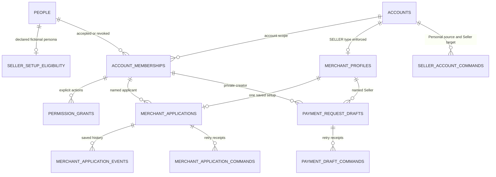

# Seller entry experience

**2026-09-09 — accepted product direction; implementation and verification remain separate.** This slice connects Personal **Quick Sell**, Household **Help a Seller**, and Seller **Get paid**. It preserves one named Seller relationship, one merchant setup workflow, and the existing Seller workspace. It does not complete acquiring, financial eligibility, payment collection, or the wider 100% target.

## Product and navigation design

| Current context | Entry and next step | Authority boundary |
|---|---|---|
| Personal | **Quick Sell** at `/accounts/{personalId}/get-paid`. Choose a named Seller already available to this person, resume its setup, or deliberately create a Seller draft. | The Personal account remains private. Creating a Seller does not convert Personal activity or funds into merchant activity. |
| Household | **Help a Seller** at `/accounts/{householdId}/get-paid`. Choose a Seller for which this person independently has accepted access and the required explicit permissions. Show recipient-owned invitations through the existing invitation journey. | Household membership, ownership, or a family relationship supplies no Seller authority. Creating one's own Seller goes through that person's private Personal context. |
| Seller | **Get paid** at `/accounts/{sellerId}/get-paid`. Show the named Seller, setup status and requirements, then existing permitted payments/settlements/disputes views. | Seller governance, permission to inspect records, merchant approval, and commercial spending approval remain independent. |

The chooser is an entry screen, not a second merchant dashboard. Selecting a Seller navigates into its canonical route; the persistent account selector, heading, task search, review and help context all change to that Seller. Never display one account's heading above another account's financial records. Preserve only validated account/resource IDs in return and resume links; do not accept arbitrary redirect URLs. A stale selection offers explicit recovery rather than silently selecting a different Seller.

Zero, one and several authorized Sellers need deliberate states. With none, Personal offers **Create Seller draft** and explains the next requirements; Household explains how to obtain named Seller access and links to the existing invitation inbox or the actor's own Personal entry. With one, show its name and current status before entering it. With several, show a searchable, bounded list. Do not assume the first account, merge their balances, or expose a Household member's other Seller relationships.

## The first usable slice

1. From private Personal, enter a Seller display name, review the named account to be created and the absence of merchant/spending approval, then save once. Canonical endpoint: `POST /api/v1/accounts/{personalId}/seller-accounts` with `{commandId, displayName}`. One server command creates the deliberate Seller draft and its creator's governance relationship. Opening the form, navigation, reload and canceled review create nothing.
2. In that Seller, complete the single saved merchant setup form. Support **Individual**, **Sole proprietor**, and **Business** as distinct declared legal forms. The bounded draft records separate fictional legal and selling names, activity description, US country selection and the named responsible applicant. Verified legal-business identity, representative authority and beneficial-owner evidence remain separate future requirements, not inferred from the selling name. Selecting a category or confirming fictional details records a declaration; it is not verification or approval.
3. Review the Seller identity, exact declared information, current requirements and the next actor. Persist draft edits and a truthful blocked/requested-review result using the agreed owning command. Only implemented states appear: a disconnected provider must not become an approval, submitted external application or completed review. Product-level approved/restricted/declined/closed states remain future outcomes until their owning lifecycle exists.
4. Existing fictional Seller activity remains visibly historical. New Seller drafts start without fabricated sales, balances, merchant approvals, cards or spending facilities. Their empty states lead to setup or explain the unavailable capability.
5. Create, edit and cancel a **private payment-request draft** in the named Seller: description, exact USD amount, one-time/reusable intent and expiry. The current actor owns the draft. Review repeats Seller, amount, mode and expiry before saving. Reload resumes saved data; cancel retains an inactive history record. Draft preparation does not require pretending merchant approval or publishing capability exists. No payment URL, QR code, guest checkout, invoice issuance, money collection, notification or financial effect is generated. The input requires a future expiry within 366 days; this is a draft scheduling bound, not a promised payable lifetime. The initial list loads the newest 100 private drafts and discloses that search covers that loaded set.
6. Helping another Seller reuses the existing intended-person invitation lifecycle: an authorized Seller actor proposes exact permissions, the named recipient reviews and accepts them, then current Seller policy permits only those actions. Decline, expiry and revocation remain visible. This slice introduces no alternative invitation engine, group-wide grant, automatic acceptance or notification delivery.

Merchant setup and commercial spending should be adjacent status explanations, not a single “active” badge. “Seller account created” means a saved context; “merchant setup saved” means saved information. Neither means “ready to accept payments” or “ready to spend.” Existing role names and account `ACTIVE` status cannot supply those missing product decisions.

## Architecture and database responsibilities

The modular monolith keeps React as a projection/command client. Seller entry and setup receive one module/command owner; account selection, access invitations, support, existing merchant servicing and future payment effects retain their existing owners.

| Record or projection | Required meaning |
|---|---|
| Existing account and accepted creator membership | Exactly `SELLER`, an explicit creator and governance role. No fourth account type or new membership-plan charge. Creation is one transactional effect per deliberate command identity. |
| Seller setup record | Typed one-to-one Seller relation, named declared merchant/legal form and representative, editable draft/version, current requirements and truthful local outcome. Originating Personal context is provenance, not a merchant or funding identity. |
| Existing memberships and explicit grants | Authority belongs to a person on the exact Seller. Read and management scopes stay separate; delegated permissions cannot exceed the grantor's current delegable ceiling. Do not copy grants from Personal/Household. |
| Setup command receipt and history | Bind actor, source/target Seller, command kind, normalized payload digest and stable business effect. Record save/submit transitions and versions without storing secrets. A retry rechecks current authorization and returns the authorized saved result. |
| Entry projection | Derive candidate Sellers from the actor's accepted relationships and live Seller permissions. Include only allowed destinations, setup state, and safe next steps. A saved shortcut is never authority. |
| Private payment-request draft | Creator and Seller foreign keys, exact integer minor amount/currency, bounded description, one-time/reusable mode, expiry, draft/canceled state and optimistic version. No public token or payment status. Dedicated owning commands validate actor scope and stable retries. |
| Merchant and commercial spending approvals | Separate product decisions and prerequisite records. Merchant setup cannot activate a spending facility; a card request cannot approve acquiring. Neither supplies settled backing. |

Use typed foreign keys and uniqueness constraints for account type, ownership and one setup record per Seller. Normalize fields rather than storing an arbitrary setup JSON document. Bound names, declarations, query input and lists; render plain text. Real identity, tax, bank/card details and uploads are outside this local slice. Later verified evidence belongs in the appropriate protected lifecycle, not an expanded free-text field.

Before mutations, use existing authenticated routes, origin validation and current policy. For source-to-Seller operations, load and authorize both relevant scopes with a documented deterministic lock order; never acquire two account locks in caller-dependent order. Recheck membership/grants and expected versions inside the transaction. Serialize command identity and business uniqueness so concurrent retries cannot create two accounts/setup records. Changed payloads on the same command conflict; a lost response retries the same identity. Do not introduce another account creation path as error recovery.

Account summaries are navigation data, not authorization. [`access/scope.ts`](../src/modules/access/scope.ts) loads current memberships and grants for [`evaluate.ts`](../src/modules/policy/evaluate.ts). [`accounts/service.ts`](../src/modules/accounts/service.ts) now uses that same scope when returning account capabilities, fixing the earlier omission of explicit grants. Seller candidates and writes also use these current inputs; role text, source-account capabilities and browser-supplied eligibility are insufficient.

## Implemented storage relationships

The typed schema is split between [`accounts/schema.ts`](../src/modules/accounts/schema.ts) and [`acquiring/schema.ts`](../src/modules/acquiring/schema.ts). Two additive migrations create eight tables, then indexes for Seller/creator draft lists and application history. Composite foreign keys enforce Seller/Personal types and actor/account/resource relationships. Setup legal name and selling name are separate; the named human applicant is not automatically the legally liable business. Local setup cannot transition to approved: the database permits that reference state only for explicitly fictional sample profiles.

The creation lock order is command-specific advisory lock → source Personal account scope → fictional applicant row → target Seller account scope. Existing setup/access commands only lock the target Seller and never acquire a source Personal lock afterward, so there is no opposite cross-account order. One transaction writes account, membership, explicit setup permissions, merchant draft, creation receipt and outbox fact. No side effect occurs during page load. Retried commands recheck current access before returning a saved result. The acquiring command order remains Seller scope → applicant → command receipt → typed records; external network work is absent.

`FICTIONAL_ADULT` is an explicit local fixture declaration, not age verification. Missing or supervised personas cannot create Seller accounts or write merchant/payment drafts. Startup never invents this designation for a new person. The explicit local seeder inserts the two named test personas and the original Sample shop's reference profile only; restarting preserves changed grants, delegation ceilings, new Seller drafts and all user-created records.

The entry response loads at most 50 permitted Sellers, 100 creator-private payment drafts and 100 recent setup events, with explicit truncation flags shown in the UI. Draft search/status filters operate on that loaded set; older-draft browsing is not implemented. Payment draft expiry is UTC and must be in the next 366 days, a local draft scheduling bound rather than a financial product rule. A server-derived `EXPIRED` state blocks edits while retaining cancellation/history. No public payment token, URL, QR or ledger balance is stored here.

## Privacy, recovery and accessibility checks

| Acceptance case | Required observable result |
|---|---|
| Personal owner creates a draft; request response is lost and retried | One Seller context/setup effect; reload resumes the same record; no new money, card or merchant approval. |
| Another person supplies a Personal ID or a foreign Seller ID | No Personal data or Seller setup leaks; no mutation. Resource unavailable response does not reveal unowned records. |
| Household owner has no Seller grant; another family member does | The owner sees neither that member's Seller records nor an implied assistance permission. |
| Recipient receives an exact Seller invitation | Pending invitation reveals only its intended review data. Acceptance grants only the reviewed Seller scope; no other accounts or spending authority. |
| Only Seller read permission is granted | Permitted records remain usable; setup/admin/respond/spending commands are denied as applicable. Owner/Manager labels alone do not widen grants. |
| Grant revoked, invitation expires, source access changes or Seller closes after page load | Next protected read/write is denied or safely redacted; a replay cannot revive access. The UI retains unsaved non-sensitive input where safe and offers refresh/account selection. |
| Competing draft edit or altered retry | Version/digest conflict with an explicit refresh step; no silent overwrite or second account. |
| Saved payment draft is retried, edited, canceled or read by another member | One creator-private draft, exact cents and versions; canceled drafts cannot be edited or republished. Another Seller member cannot read it, and no balance, sale, card or provider record changes. |
| Individual or sole proprietor selected | Named responsible-party fields work without requiring a fabricated company. Self-declaration is not presented as verified eligibility. |
| Household participant may be supervised | No independent minor merchant onboarding or commercial borrowing. Missing guardian/age controls remain a prerequisite, not a checkbox that authorizes them. |
| Back, forward, reload, direct link and keyboard dismissal | Correct source/Seller context remains visible; commands do not repeat; dialog focus returns to its trigger. |
| Desktop and 320-pixel review | Fields have stable labels, errors retain values, long Seller names wrap, modal scrolling works, and review confirms exact account/permissions without horizontal overflow. |

Browser API/UI/accessibility tests use fresh fictional records in `etail_depot_next_test`, existing login helpers, and the final contracts/selectors. They cover allowed and denied paths, transport ambiguity, current-access changes, and unchanged financial/card records. [Delivery evidence](SELLER_ENTRY_EVIDENCE.md) records the complete 89-test browser run, 249 core tests and visual review on the actual tested revision. No shared preview was reset and existing denial assertions were retained.

## Dependencies and honest limits

This is a bounded entry/setup portion of [EDN-017 and EDN-020](../planning/backlog.json), not closure of either milestone. EDN-017 still depends on EDN-006/008/009; EDN-020 still depends on EDN-007/012/019. Merchant approvals, hosted identity/verification, responsible-party and guardian policy, real/future mock provider processing, payment-request publication/checkout, refunds, reserves, payouts, one immutable ledger and commercial backing/repayment remain separate required work. `ENABLE_REAL_MONEY=false` remains enforced. No source amount, plan fee, shared Premier cap, privacy rule, Netlify access choice or release authorization changes through this entry slice.

Authority: [master account/acquiring rules](../02_MASTER_BUILD_PROMPT.md), [Product](PRODUCT.md), [Access policy](ACCESS_POLICY.md), [Canonical workflows](WORKFLOWS.md), [Database/domain](DATABASE_AND_DOMAIN.md) and [UX contract](UX_CONTRACT.md). These Etail requirements govern legal responsibility and permissions; Amex front-end research informs interaction design only.
