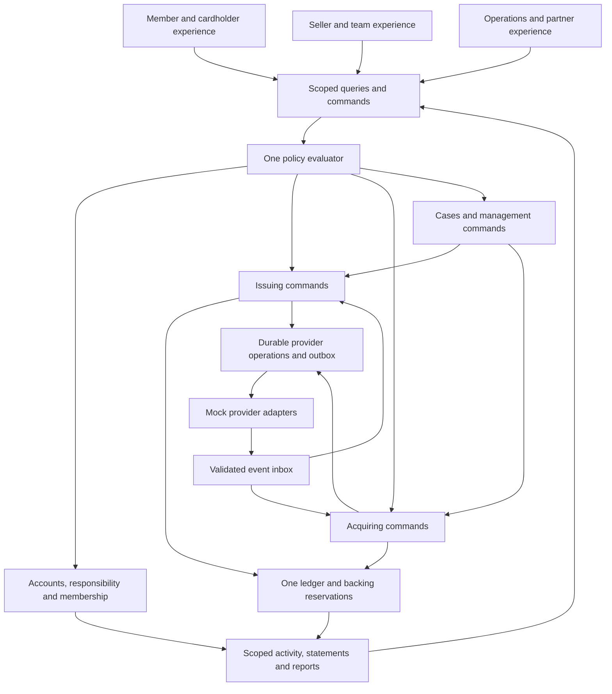

# Amex reference architecture and management blueprint

Research date: 2026-09-08. Read with [the research index](README.md), [issuing study](ISSUING_AND_CONSUMER.md) and [merchant study](MERCHANT_AND_OPERATIONS.md). This document proposes Etail architecture from observed public behavior. It does not describe Amex's private database, services, risk models or operating procedures.

## What the evidence establishes

| Evidence | Observed public behavior | Consequence for the Etail design |
|---|---|---|
| A01 — [2025 annual report, printed pp. 2–4](https://s26.q4cdn.com/747928648/files/doc_financials/2025/ar/American-Express-Annual-Report-2025.pdf) | Amex combines issuing, acquiring and network businesses; it has direct relationships and contractual partner relationships. | Model the whole payment journey, keeping issuer and merchant obligations distinct. This business topology does not establish a particular software deployment architecture. |
| A02 — [Account Manager terms, Dec. 2023, pp. 3–4](https://www.americanexpress.com/content/dam/amex/us/customer-service/account-management/account-managers/terms-conditions.pdf) | Permissions differ by access level, product and channel. Limited Access includes online payment scheduling. Full Access online additional-card creation is marked Business-only. | Never translate “Limited” into Etail Viewer or “Full” into unrestricted Owner. Define explicit actions and resource scopes. Rendered checkmarks were visually inspected. |
| A03 — [US Company Profile guide](https://www.americanexpress.com/en-us/business/resource-center/statements-payments/articles/company-profile-guide/index.html) | Company hierarchy, consolidated exposure and aging coexist with separate banking-officer and payer responsibilities. Payments have review and tracking. | Separate banking mandate, payment execution, reporting and spending. The current account-directory foundation can support these relationships. |
| A04 — [UK reconciliation administrator guide, July 2022, pp. 4–5, 8–12, 16–21, 25](https://www.americanexpress.com/content/dam/amex/en-gb/business/resource-centre/atwork-reconciliation/AT_Work_Recon_Prog-Admin-User-Guide_Final.pdf) | Role and card/site assignment are separate. Accounting values are validated; imports show task history and failures; extracts are scoped to accessible sites. | Use resource assignments, versioned accounting rules and durable import/export jobs. Never copy the guide's account/user deletion periods or destructive import defaults. |
| A05 — [@ Work global reporting guide, pp. 13–15, 18–19](https://www.americanexpress.com/content/dam/amex/it/business/resource-centre/work-reporting/Work-Reporting-Global-Guide-English.pdf) | Reports cover card activity, approaching limits, delinquency, organization, allocation and virtual-card exposure. Availability varies by program; line-item detail can be absent. | Reports answer specific operating questions. Record completeness, scope and freshness rather than inventing missing detail. The cardholder-report page was visually inspected. |
| A06 — [Network certification](https://network.americanexpress.com/globalnetwork/certification/) | Issuers and acquirers have host certification; cards and POS products add distinct certification work. Detailed specifications require Knowledge Base access. | Keep partner certification, message compatibility and product capability separate. Local tests cannot establish Amex certification. |
| A07 — [SafeKey](https://network.americanexpress.com/globalnetwork/v4/products/safekey) | Amex uses EMV 3DS with frictionless and challenged authentication; merchant enablement goes through its PSP/3DS provider. | Keep customer authentication distinct from financial authorization. Preserve challenge, abandoned, timed-out and uncertain results in the payment operation. |
| A08 — [Tokenization services](https://network.americanexpress.com/globalnetwork/v4/products/card-on-file-tokenization/tokenization-services.html) | Tokenization covers stored credentials, wallets and other use cases with domain controls and separate enrollment. | A card, a provider token and a device enrollment need different lifecycle records; a QR payment link does not imply network-token QR support. |
| A09 — [Passkeys FAQ](https://www.americanexpress.com/us/customer-service/faq.passkeys.html) | Users can manage passkeys; password access remains available. | Record passkey support as a desired experience awaiting Identity capability proof. Do not create a second authentication engine to claim parity. |
| A10 — [US Security Center](https://www.americanexpress.com/en-us/security/) | Saved-device management, two-step verification and fraud notifications are customer-facing controls. | Provide recovery and revocation alongside security settings. An alert delivery failure must be visible to operations. |
| A11 — [Amex Sync](https://www.americanexpress.com/en-us/business/sync/) | Selected partners can embed virtual cards and transaction data for eligible US Business/Corporate accounts. Current partner eligibility requires US operations; acceptance precedes API access. | Evaluate a future Seller commercial-card integration. It does not establish Personal/Household issuing support or merchant acquiring for Etail. |
| A12 — [US reconciliation fact sheet](https://www.americanexpress.com/en-us/business/resource-center/reconciliation/articles/reconciliation-fact-sheet/) | Centrally billed transactions support accounting-code allocation, exception review, approval levels, receipts and ERP extracts for specified products. | Add expense review and accounting-export workflows to the same activity model. Accounting allocation must not modify posted financial journals. |
| A13 — [Japan merchant home](https://www.americanexpress.com/ja-jp/business/merchant/) | A distinct merchant entry point offers transaction, transfer and billing information, plus merchant-information procedures. | Geography and channel belong in the evidence record. A US guide is not proof of Japanese program availability or identical screens. |

Source records and limitations are in [architecture-sources.json](architecture-sources.json). Live pages without a visible publication date are marked undated, not newly published. The annual report was used for business relationships only, not as independent validation of marketing performance claims.

## Proposed architecture: one coherent financial application

This is an **Etail design proposal**, constrained by the existing master. Public workflow similarity is compatible with a modular monolith; reproducing Amex's undisclosed deployment topology is neither required nor measurable here.

The financial modules own business state; the ledger owns monetary effects. Operations invokes the same commands with explicit staff authorization. An operator page never posts money directly. A later approved provider adapter replaces a mock boundary without introducing a second card creator, ledger or policy engine.

### Relationships and ownership

| Record or relationship | Required meaning | Boundary to test |
|---|---|---|
| Person + identity binding | Who signs in; provider issuer/subject identifies the binding. | A matching email cannot seize another person's account. |
| Account + accepted relationship | PERSONAL, HOUSEHOLD or SELLER context and explicit access. | Switching accounts changes scope without inheriting prior authority. |
| Responsible party | Who carries the product obligation; independent of display name and team role. | Changing Manager never changes liability. |
| Membership sponsorship | Which membership supplies entitlements and receives source-attributed benefits. | New cards/accounts never create another Premier bonus cap. |
| Facility + funding allocation | Approved product, currency, repayment policy and explicit backing assignment. | Two accounts cannot spend the same backing twice. |
| Card request + provider operation | Saved intent, applicant/holder, prerequisites, version and stable external operation identity. | Timeouts/retries never manufacture a second card. |
| Card + controls + optional provider token/device | Instrument state and separate restrictions/registrations. | A replacement preserves history; a token update does not create credit. |
| Merchant + location + settlement destination | Named Seller legal context; presentation location distinct from payee relationship. | A location is not a fourth account type or an automatic payout entitlement. |
| Payment + settlement + payout | Collection obligation, aggregation/reconciliation and outbound transfer are separate. | Pending sales and reserves cannot be paid or pledged. |
| Dispute/case + evidence + financial effect | Service process and financial outcome with separate status histories. | “Case closed” never implies refunded or balance restored. |
| Accounting allocation + export run | Expense coding, report selection and export provenance. | Editing a cost-center code never rewrites a posted journal. |

Do not add an organization/account-hierarchy engine to Household just because corporate Amex has control accounts. Begin with typed Seller locations and narrowly scoped reporting groups when needed. Each aggregate report must carry authorized member accounts/locations, currency, period, time zone, data cutoff and missing-source indicators. Cross-currency totals require an explicitly labeled conversion basis; they are not spendable money.

### Command and event rules

Every protected command resolves actor, account, resource, product, current policy and environment server-side. Its durable record includes the requested payload/version, business request ID, prior state, result state, safe reason and correlation ID. High-impact approvals bind the payload digest and independent approver; a changed amount or destination invalidates prior approval.

In one PostgreSQL transaction, financial commands lock relevant shared backing, check limits, record the domain transition, append balanced journal effects where applicable, and enqueue durable work. Use unique business-effect identities for authorizations, clearings, refunds and payouts. Provider response handling distinguishes explicit rejection from unknown outcome. Reconciliation checks the established operation before resubmission; HTTP retry headers alone are insufficient.

Verified events have provider/event identity, event and received timestamps, account/resource mapping, payload version and processing outcome. Duplicate delivery is harmless. Out-of-order events wait, resolve through known transitions or enter a visible exception queue. Frozen/revoked user access blocks new requests while genuine historical clearing continues to reconcile. Do not claim an exact-once transport guarantee; enforce unique effects in the database.

### Linked issuing/acquiring example

A fictional $100 purchase on an approved adult pay-in-full facility has separate cardholder and Seller views tied to one correlation chain. Issuing first reserves eligible capacity. Clearing records the purchase obligation and consumes/releases the hold through the canonical ledger writer. Acquiring records the merchant's pending/settled receivable, the actual known fee components and reserve obligations. Only eligible settled, unreserved funds enter payout availability. A refund or dispute links back to the original purchase and settlement rather than editing history. Supervised spending instead consumes guardian-funded amounts and creates no independent borrowing or child repayment obligation.

The sandbox may know both sides of a simulated payment, but it cannot reveal the cardholder's private account to the merchant or the Seller's cost model to the cardholder. Self-payments/circular transactions cannot earn rewards. Externally acquired sales and externally issued purchases need not have an Etail counterparty; retain external references without inventing local accounts. Exact posting templates remain an EDN-009 deliverable; this diagram is not a substitute for them.

## Management operating model

These are proposed Etail responsibilities and queues, not a reconstruction of Amex staffing, service levels or internal fraud rules.

| Team/function | Work queue and permitted actions | Completion evidence |
|---|---|---|
| Customer support | Access/application/card-service cases; customer-visible updates and escalation. | Named owner, safe next step, response history and resolution reason. No implicit financial adjustment power. |
| Issuing operations | Stalled issuance, replacement, activation, control-sync failures and unmatched clearing. | Provider operation reconciled; stable card identity and financial result; no second issuance on retry. |
| Merchant operations | Missing submissions, settlement mismatches, enrollment or account-update failures. | Component totals and provider references reconciled; destination and entity scope verified. |
| Disputes team | New/reply-due/evidence-failed/provider-review/closed cases. | Deadline, accepted evidence version, provider response and explicit money outcome. |
| Finance/treasury | Unmatched settlements, pending/failed payouts, repayment returns and balance exceptions. | Independently approved command where required; journal and bank/provider reconciliation reference. |
| Access/program administrator | Invitations, scoped grants, resource assignments, revocation and access review. | Exact before/after grant and delegable ceiling; no implicit spending or bank-changing authority. |
| Accounting reviewer | Receipts, categories, allocation exceptions and export failures. | Validated allocations reconcile to source activity; frozen export artifact and manifest. |
| Platform operations | Event lag, dead letters, provider outages, job failures and recovery. | Safe replay, duplicate-effect checks and restored processing; no raw secret payload in support logs. |
| Economics/partner management | Missing cost inputs, approved rate versions, sponsor attribution and partner statements. | Traceable Planning/Contracted/Actual basis and original Etail commercial regressions. |

An operations case needs status, assignee/team, priority, deadline source/time zone, linked resources, customer/internal visibility, evidence versions and history. SLA durations stay configurable and explicitly sourced; no invented Amex guarantee. Customer replies, operator notes and provider evidence are separate visibility classes. Attachment processing failures preserve the case and permit safe replacement. Escalating a case never grants broader data access.

Proposed operating cadence: monitor pending and failed operations continuously while the tested bounded worker is enabled; reconcile source totals and exceptions for each simulation business day; close statements at the product calendar boundary; review access and unresolved cases on a configured schedule. Scheduled processing remains gated by the original milestone rules. Track oldest pending operation, unmatched amount/count by currency, case reply deadlines, duplicate effects prevented, failed notifications and export completeness. Choose service targets from actual capability and tests, not Amex marketing.

## Screen and experience specification

The following describes Etail screen structure and interaction fidelity. No authenticated Amex customer session was inspected. Public illustrated guides establish some task flows, but cannot prove current responsive layouts, exact clicks, performance or all role variants.

| Surface | Information priority | Primary action and recovery |
|---|---|---|
| Account overview | Persistent account/type, role, service readiness, distinct financial summaries, recent activity, action-needed items. | Show one relevant next action; restore a saved request after resolving prerequisites. Never choose the first account. |
| Card detail | Holder and account, instrument status, source allocation, effective limits/usage, pending and posted activity. | Freeze/unfreeze, limits or replacement according to server capabilities. Explain a parent freeze or pending provider confirmation. |
| Add card | Selected account, eligible holder, details/controls, review, saved status. | One route/form and request ID; preserve draft on validation or session expiry. Unknown provider outcome stays pending. |
| Activity detail | Status, merchant/descriptor, original and posting dates, amount/currency, receipt and lifecycle timeline. | Attach receipt, request help or dispute when permitted. Missing enrichment stays explicitly missing. |
| Statement/payment | Statement period, purchases to repay, due date, payment history and separately identified scheduled payments. | Review a mock payment, retain reference, track result; do not portray scheduled as received. |
| People & controls | Person, role template, exact grants, card/resource assignments, invitation status and responsibility. | Preview/review change, then audit result. Revocation explains downstream effect without deleting financial history. |
| Seller payments | Sales activity, submissions/settlements and payout availability as distinct views. | Drill from payout to components. Explain reserve, missing report, delayed data and failed payout separately. |
| Merchant dispute | Reason, amount, reply deadline, timeline, evidence checklist and accepted response status. | Resume response; distinguish uploaded, validated and submitted evidence. Show already-refunded paths. |
| Management reports | Saved filters, report scope/period, completeness, totals and related exceptions. | Run/export via durable job, then retrieve authorized artifact; label partial results. |
| Help/security | Current account context, cases, devices/sessions, recovery and notification preferences. | Revoke access or continue help with context; protect identity without a second login implementation. |
| Closure/offboarding | Requested closure, remaining obligations/holds, refunds, disputes and in-flight payouts. | Stop new activity, explain work blocking final closure, revoke access as permitted and retain history/reconciliation. |

Use original Etail assets, readable typography, restrained panels and consistent detail navigation. Match task clarity, status visibility and depth of control rather than copying logos, card art or marketing claims. Put optional controls in the relevant form; keep raw provider diagnostics in authorized operational views. At 320px, retain account identity and action status, reflow tables into accessible row details and preserve keyboard/focus order. Disabled actions explain the missing prerequisite without leaking hidden financial data.

## Actual Amex integration fit

**Recommendation:** preserve a provider-neutral domain with mock adapters now; put Amex Sync first on the commercial virtual-card integration shortlist, and assess acquiring through an eligible processor separately. This is a proposed evaluation order, not an application to either program.

For Sync, first verify operating geography, partner eligibility, supported existing account types, authorization/consent, holder controls, event delivery, token handling, reconciliation, service limits, costs and exit/export rights. The public page supports the existence of the program; it does not reveal enough executable API contracts to implement a production adapter. Etail's secured consumer facility and guardian-funded Household do not automatically map to it. Existing-card integration and new financial-product origination are distinct propositions.

For acquiring, evaluate transaction submission, settlement detail, refunds, disputes, payee changes, payout support and supported markets at the chosen provider boundary. Direct Amex-network participation has separate host/product certification. Keep unresolved response-code mappings and message versions explicit. No connector should infer production permission from a successful mock test or a public documentation URL.

The developer @ Work and Card On-Demand URLs failed public retrieval in this session. Legacy gateway documentation appeared in search, but exact endpoint pages could not be inspected; the versioned snippets are discovery leads only. No SDK, live endpoint, callback signature, webhook guarantee or negotiated contract has been validated.

## Implementation order and review gates

1. **M0/M1, EDN-004–008:** finish hosted Identity compatibility and account/member/responsibility/invitation/grant relationships. Retain the tested local foundation. Prove owner/cardholder/manager/viewer separation before extending financial behavior.
2. **M2, EDN-009–012:** executable ledger/backing contracts, one saved card request, application/status screens, replacement and hierarchical controls. Design application-operations projections within these slices; deliver the full staff workflow under EDN-021.
3. **M3, EDN-013–016:** shared-backing authorization, durable purchase lifecycle, late clearing/reversal, product-specific repayment/statements and Etail reward attribution. Resolve D14–D17 for affected writes.
4. **M4, EDN-017–020:** named merchant and locations, guest collection, settlement and adjustments, refund/dispute evidence, reserves/payouts and scoped Seller teams.
5. **M5, EDN-021–024:** operator queues, accounting reviews/reports, guarded adjustments, cost completeness and partner servicing through the same commands.
6. **M6/M7:** exercise the comparison catalog, role variants, mobile/accessibility and recovery; retain mandatory financial/security acceptance and hosted release review. A 90% comparison score cannot waive any of these gates.

Research additions are a detailed planning overlay on [the existing backlog](../../../planning/backlog.json). They are not completed migrations, new live-provider authority or a claim that any financial milestone is implemented.
