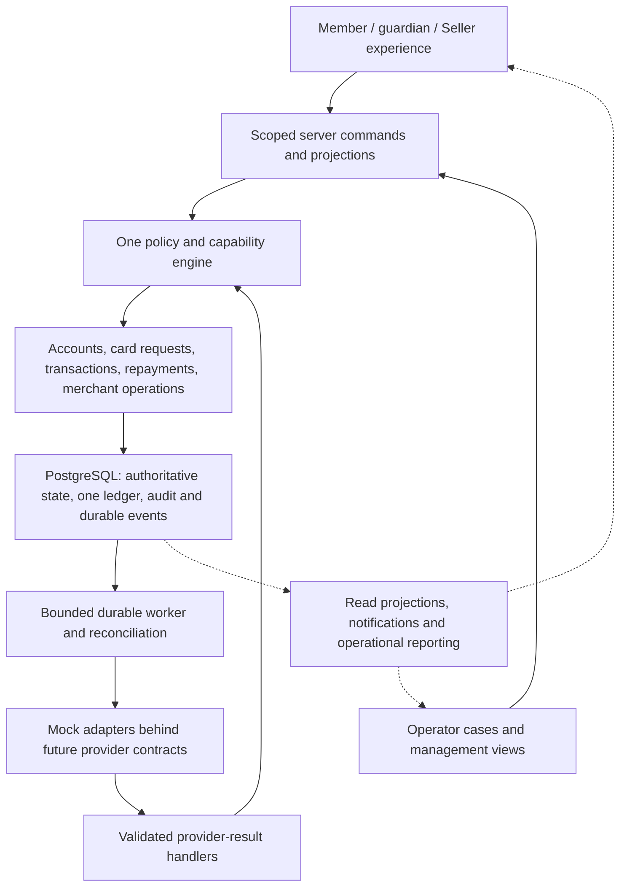

# Amex architecture investigation and Etail design blueprint

Research date: 2026-09-08. Follow-up to the user's request to investigate Amex's vendors, IT providers and internal architecture in greater depth.

## What this investigation changes

The earlier study concentrated too heavily on product documentation and generic component choices. Public evidence goes substantially deeper: Amex has disclosed core-network architecture through its own engineers, and providers have documented specific internal implementations. These findings now complement the issuing, consumer, merchant and management workflow studies.

The right unit of analysis is a **subsystem with a dated source and a defined responsibility**. Treating every supplier as part of one Amex stack would produce false connections. Several useful findings concern historical deployments, research projects or affiliated businesses. Those differences are preserved below and in the registers.

## Reading path

| Study | What it establishes | Where the detail lives |
|---|---|---|
| Core platform | Specific operational architecture publicly disclosed by Amex | [PLATFORM_ARCHITECTURE.md](PLATFORM_ARCHITECTURE.md), [P source register](platform-sources.json) |
| Suppliers and servicing | Named provider relationships, systems and responsibility boundaries | [VENDOR_SYSTEMS.md](VENDOR_SYSTEMS.md), [V source register](vendor-systems-sources.json) |
| Fraud and data | Serving components, analytical infrastructure, research and conflicting claims | [PAYMENTS_DATA_ARCHITECTURE.md](PAYMENTS_DATA_ARCHITECTURE.md), [T source register](payments-data-sources.json) |
| Actual source and inventions | Inspected Amex code, extension seams, public design disclosures and patents | [ENGINEERING_AND_PATENTS.md](ENGINEERING_AND_PATENTS.md), [E source register](engineering-patent-sources.json) |

## Evidence map: the parts we can now identify

| Area | Concrete public evidence | What remains unproven |
|---|---|---|
| Payments-network routing and processing | Amex's 2026 network disclosures and earlier engineer conference decks, P01/P02/P07/P08 | Full current service inventory, financial-posting schema and every failover algorithm |
| Cardholder repayment | Finastra Global PAYplus remittance case, V03; narrower Infosys/TCS implementation claims, V04/V05 | Current versions, worldwide completion and whether those vendor accounts describe the same deployment |
| Customer service | Pega Relationship Care testimony, V02 | Exact case schema and current engine; no proof of Amex-wide Smart Dispute use |
| Corporate relationship management | Salesforce Corporate Payments account-collaboration case, V01 | Current synchronization and authoritative financial-data boundaries |
| Authentication | Historical Gravity ACS approval, P06 | Present approved version, current production footprint and full challenge decision logic |
| Fraud model serving | NVIDIA's scoped deployment account, reviewed in the data study | Exact recurrent-model variant and current model/rules; experimental GNN work is separate |
| Data/analytics | Firsthand Amex data-platform interview and later research disclosures in the data study | Today's topology, data lineage, feature contracts and production promotion of research |
| Web composition | Inspected One App lifecycle, request store and module loading, E01–E04 | Which exact customer properties run the inspected revision today |
| Workflow execution | Inspected Flowret runtime, execution persistence and DAO seam, E05–E07 | Deployment within any specific Amex financial system and atomicity across its host application's domains |
| API composition | Synapse architecture and reactive controller, E08/E09 | Complete financial control semantics or proof it is the core issuer platform |
| Infrastructure operations | Amex's historical IBM outsourcing statement, V06/V07 | Current supplier scope and contractual renewal |
| Loyalty delivery | Current primary Cognizant recruitment signal, V08 | Completed deployment or company-wide adoption of the advertised skills |
| Issuer core accounts, statements and general ledger | Product outcomes are documented by the earlier study | A verified current supplier/runtime/schema mapping is still missing; neither a remittance hub nor a network switch fills this gap |

Source URLs and precise locators are in the linked studies; each register records scope and limitations. This map does not assert synchronous connections between these systems. For example, it does not connect Pega to Finastra by an invented Kafka bus, or claim that Salesforce owns account balances.

## From evidence to one coherent Etail architecture

This diagram is **our proposed Etail implementation**, informed by the research and existing requirements. It is not an Amex topology. All financial providers remain simulated; existing project contracts govern the final executable state names and economics.

The Policy return arrow means result handlers enforce applicable resource and domain invariants. It does not mean a later freeze/revocation allows discarding a legitimate earlier clearing, refund or reconciliation event. User-command permission and provider-event processing rules are distinct checks inside the same owned design.

The implementation should make these records reviewable before adding more infrastructure:

| Record / ownership | Required information | Failure it prevents |
|---|---|---|
| Scoped command envelope | Command ID, actor, selected account, resource, requested operation, payload identity, rule version, audit correlation | Cross-account action, replay with altered payload or duplicated effect |
| Responsibility relationship | Legal/product responsibility, spending authority, administration authority, funding assignment, validity and revocation | Treating manager, holder, borrower and funder as interchangeable |
| Saved card request | Original intent, review/approval history, eligibility evidence, provider correlation and mapped operational substate | Separate creation paths or optimistic issuance completion |
| Provider operation | Intended effect, dispatch evidence, retries, acknowledgement, timeout uncertainty, final result and reconciliation owner | Blind retry after an external effect may already exist |
| Financial journal and links | Exact money/currency, business effect identity, posted entries, hold/capture/adjustment relationships | Editable financial history, unbacked capacity or two financial writers |
| Remittance instruction | Payment method, party responsibility, submitted amount, bank/provider references, settled/returned evidence | Marking a bill paid merely because a payment instruction was accepted |
| Merchant route profile | Merchant/location, submitting party, processor/acquirer, funding party, dispute route and program scope | Mistaking forwarding/acceptance for settlement responsibility |
| Case and action evidence | Reason, affected object, queue, assigned responsibility, age/deadline, permitted command, evidence access and outcome | Unresolvable pending states or privileged operator shortcuts |
| Projection checkpoint | Last applied event, freshness, rebuild/reconcile status and scoped presentation | A stale report silently deciding spend or hiding unresolved work |
| Reference/rule version | Source, effective period, inputs, exact calculation basis and retained version | Unreproducible costs, rewards and changing results after retries |

These are logical record requirements, not a final SQL schema. Reuse the existing foundation's accounts, scoped grants, sessions and outbox concepts. Resolve schema changes through implementation review rather than creating a second general CRUD or workflow engine.

## The first vertical design exercise

Use one fictional Seller owner and one employee, keeping spending permission separate from administration. Establish the responsible membership/funder and an explicit backed capacity before any card is issued.

1. The employee or authorized requester saves an intent in the single card-request lifecycle. The allowed approver reviews the same record. The server checks account scope and issuance authority.
2. The issue command persists an operation identity and dispatches through the mock adapter. Simulate the provider accepting the request while its response is lost. Show a truthful unresolved state and an operator recovery path. Reconcile to one issued card.
3. Run a backed mock purchase through atomic controls. Send duplicated and late provider events. Preserve the distinction between current spending restrictions and valid financial events from earlier activity.
4. Apply clearing, a partial refund and the associated exact journal effects. Show the cardholder view and the Seller statement/repayment obligation under Etail's actual commercial rules.
5. For the merchant counterpart, link submission, settlement, reserve/adjustment and payout evidence under the existing acquiring slice. Do not infer that the card issuer and merchant funding party are always the same provider.
6. Let the operator trace the unresolved event, fix it through a permitted command, and demonstrate that user/merchant projections reconcile. Verify that a viewer cannot perform the same action.

This is a connected specification and subsequent implementation sequence, not a shortcut around dependencies. M1 responsibility and grants must precede M2 issuance; M3 financial behavior precedes M4 settlement; corresponding cases are designed in each slice and completed through M5. The original account types, membership cap, supervised-funding model and commercial ambiguities D14–D17 remain visible.

## Open source and supplier choices

**Inspect and adapt narrowly.** One App demonstrates actual web-composition mechanics; Flowret exposes workflow extension/persistence seams; Synapse shows service layering. Their source can answer precise engineering questions. None is an Amex bank-in-a-repository, and none automatically supplies Etail's authority, ledger, economics or recovery invariants. Read [the source-level assessment](ENGINEERING_AND_PATENTS.md) together with [the earlier license/component review](OPEN_SOURCE_COMPONENTS.md).

**Distinguish a pattern from a procurement decision.** A successful Amex deployment is useful evidence to evaluate a component, but does not prove its cost, license, operating burden or fit for this project. Finastra, Pega, Salesforce and GPU infrastructure are not selected dependencies. The immediate reusable work is explicit state ownership, adapter contracts, durable recovery and coherent service context within the current Next.js/PostgreSQL implementation.

**Do not adopt patents as implementation specifications.** The patent study supplies ideas, participants and state transitions for comparison. Patent publication is neither deployment evidence nor an open-source license. This task performs no legal-status or freedom-to-operate assessment and does not implement claims.

## Review gates and similarity target

[Twelve proposed architecture gates](../../../planning/amex-architecture-gates.json) cover stable command identity, uncertain results, crash recovery, atomic controls, durable audit, reference versions, safe replay, load/failure regression, reconciliation, operator authority, restoration and source attribution. All are proposed and unassessed; no tests are claimed to exist merely because a criterion is written.

Keep the [90-task public-product comparison](../../../planning/amex-comparison.json) unchanged. The user's 90%+ goal remains the product/experience benchmark. Architecture should be judged by sourced relationships and tested behavior, not an unverifiable percentage of a company's undisclosed systems. These twelve refinements supplement the existing twenty mandatory gates; they do not replace or dilute them.

## Remaining research gaps, in priority order

1. **Issuer account and statement engine:** seek a current Amex-authorized case or engineering disclosure identifying ownership, posting/statement boundaries and service contracts. A vendor brochure saying it supports Amex cards is not adoption evidence.
2. **Merchant clearing, reserves and funding internals:** product/report guides show outcomes; the reviewed network architecture does not establish settlement accounting or reserve algorithms. Keep these Etail rules explicit until a suitable primary source or authorized partner contract exists.
3. **Current servicing integration:** historical cases establish systems, but do not show how present staff tools invoke financial commands, assign approval authority or enforce data segmentation.
4. **Current risk and data lineage:** serving components and research are available; model features, thresholds, feature freshness and present production control paths remain incomplete. Do not manufacture these from vendor benchmark claims.
5. **Authenticated experience and partner contracts:** public materials cannot complete a hands-on role-specific product walkthrough or establish Etail's program entitlement. If authorized demonstrations or partner documents become available, record provenance and update the evidence without treating them as retroactive proof.

This is a completed bounded investigation of the sources recorded in the registers, not a claim to have exhausted every resource or obtained Amex's entire private architecture. No provider was contacted, no confidential repository or portal was accessed, and no application or deployment was changed. [Validation and closeout](ARCHITECTURE_VALIDATION.md).
