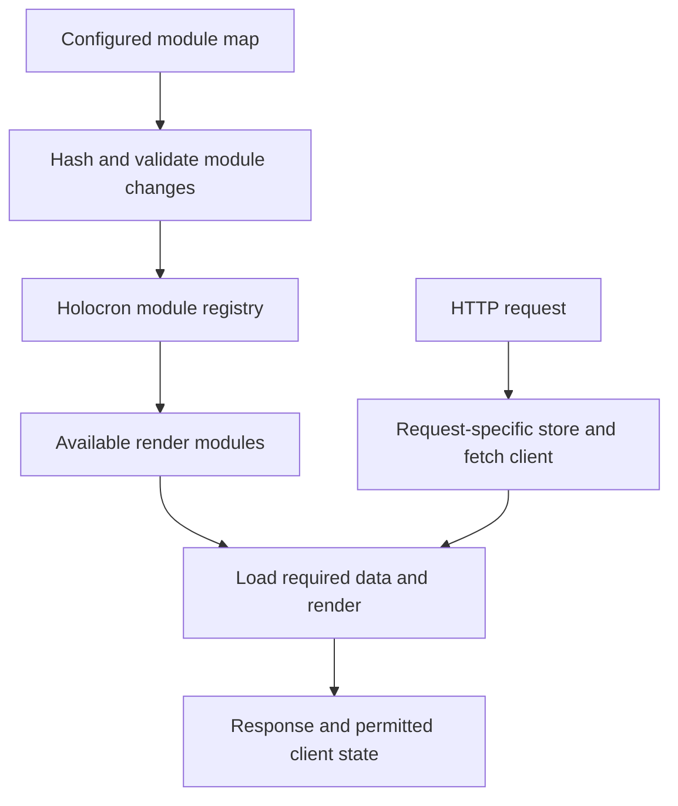
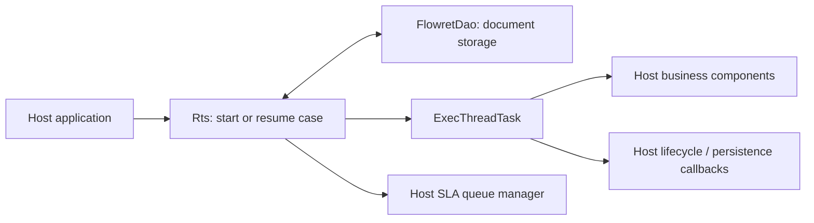

# Amex engineering code and patent disclosures

Research date: 2026-09-08. This study examines implementation relationships visible in Amex-owned public repositories and financial designs described in Amex-origin patent publications. It complements [PLATFORM_ARCHITECTURE.md](PLATFORM_ARCHITECTURE.md), which covers named engineers' accounts of the deployed payments network, cells, routing and migration. Those accounts are stronger evidence of deployment than the mere presence of a repository.

The useful result is a set of concrete boundaries: request rendering versus backend authority; workflow execution versus storage guarantees; service logic versus transport adapters; customer intent versus delegated credentials; authorization versus financial capture. These are references for Etail's design, not a recovered current Amex issuer schema. No reviewed source connects all these components into one production call graph.

## Evidence and inspected revisions

The register contains 13 primary sources: nine code/document files pinned to three repository commits, one first-party engineering article and three patent publications. Repository files were read through GitHub; no upstream code was cloned, installed or executed. The patent text and figures' descriptions were read through Google Patents. No gated portal or unpublished material was accessed.

| Evidence family | Observed revision or publication | What it can establish |
|---|---|---|
| One App / Holocron integration, E01–E04 | `7a8181ddb3893ababd8bd26c76b4f1773931149c` | Documented lifecycle and actual module/request code at this revision |
| Flowret, E05–E07 | `1449bebe1051dd09a268735a982aad350e1280cb` | Case execution, persistence interface and failure handling at this revision |
| Synapse, E08–E09 | `ea981729a13e7e56a8d678c9292c6e00c3bbcf61` | Published library boundaries and concrete reactive controller types |
| Amex Agentic Commerce Experiences, E10 | 2026-04-22 | Named Amex engineering authors' published design |
| US7835960B2, E11 | 2010-11-16 | Proposed transaction-number and capture relationships |
| US7962408B2, E12 | 2011-06-14 | Proposed allocation and financial submission relationships |
| US20230206197A1, E13 | 2023-06-29 | Proposed supplier payment/reconciliation relationships |

The full source titles, URLs, evidence and limitations are in [engineering-patent-sources.json](engineering-patent-sources.json). Repository ownership and code copyright identify an Amex contribution; neither proves current production use. Existing license, maintenance and reuse assessments remain in [OPEN_SOURCE_COMPONENTS.md](OPEN_SOURCE_COMPONENTS.md). This study does not repeat that dependency inventory.

## 1. One App: application composition has a different lifetime from a request

The lifecycle guide separates initial module-map validation and module loading from subsequent polling and from the data/render work for each request. Startup loading failure can prevent the server from accepting requests. The actual loader hashes the fetched map, avoids an unchanged update, passes changes to the Holocron registry, records rejected modules, and refreshes the client module-map cache and root-controlled CSP when applicable. [E01 — lifecycle](https://github.com/americanexpress/one-app/blob/7a8181ddb3893ababd8bd26c76b4f1773931149c/docs/overview/Lifecycle.md); [E02 — module loader](https://github.com/americanexpress/one-app/blob/7a8181ddb3893ababd8bd26c76b4f1773931149c/src/server/utils/loadModules.js).

The request implementation creates a new Holocron store, constructs a fetch client with the current request/reply, supplies separate server-state and client-initial-state configuration inputs, and attaches the store to that request. This is a concrete isolation seam. It does not alone prove that every serialized value or downstream fetch is safe: this review did not audit the complete serialization path. The guide's Express wording and this code's Fastify types also demonstrate why an architecture reconstruction must preserve revision and source boundaries. [E03 — request store](https://github.com/americanexpress/one-app/blob/7a8181ddb3893ababd8bd26c76b4f1773931149c/src/server/plugins/reactHtml/createRequestStore.js); [E01 — guide](https://github.com/americanexpress/one-app/blob/7a8181ddb3893ababd8bd26c76b4f1773931149c/docs/overview/Lifecycle.md).

Our simplified reconstruction of those files:

The API guide shows `loadModuleData` and `fetchClient`, plus Fetchye provider/cache integration for deduplication across modules. Its books example demonstrates data loading, not a payment API. A shared fetch cache is an optimization, not an authorization decision. [E04 — API-call guide](https://github.com/americanexpress/one-app/blob/7a8181ddb3893ababd8bd26c76b4f1773931149c/docs/guides/Making-An-Api-Call.md).

**Etail interpretation:** retain one Next.js application with request-scoped account context and server-created projections. Cache only where the project's privacy rules allow it; any permitted projection cache must distinguish actor, account, resource scope and relevant version. Re-evaluate commands on the server. Do not adopt a runtime module marketplace, another React framework or a browser-owned eligibility store. A module map and a current-account preference are entirely different authorities.

## 2. Flowret: explicit case execution, with persistence supplied by the host

`Rts` accepts a DAO, a process-component factory, an event handler and an SLA queue manager. `startCase` associates journey data with a case key, constructs process information and starts execution; `resumeCase` reloads case context and applies supplied variable updates. Lifecycle events and SLA handling are separate callbacks. This is code-level evidence for resumable case orchestration, not evidence that an Amex authorization or settlement system uses this exact engine. [E05 — runtime service](https://github.com/americanexpress/unify-flowret/blob/1449bebe1051dd09a268735a982aad350e1280cb/src/main/java/com/americanexpress/unify/flowret/Rts.java).

The persist step invokes `ON_PERSIST`; an exception moves the execution path to `ERROR_PEND` with the configured error workbasket. Parallel-route handling records process/audit information before launching branches, subject to configuration. The code therefore makes waiting and error handling visible rather than treating every step invocation as completed business work. [E07 — execution task](https://github.com/americanexpress/unify-flowret/blob/1449bebe1051dd09a268735a982aad350e1280cb/src/main/java/com/americanexpress/unify/flowret/ExecThreadTask.java).

The storage interface has only `write(key, Document)`, `read(key)` and `incrCounter(key)`. It declares no transaction spanning multiple business records, compare-and-swap or external-effect commit. This is a limitation of what the interface proves, not a finding that every implementation is unsafe. Likewise, an in-process lock cannot establish serialization between independent workers. [E06 — DAO contract](https://github.com/americanexpress/unify-flowret/blob/1449bebe1051dd09a268735a982aad350e1280cb/src/main/java/com/americanexpress/unify/flowret/FlowretDao.java); [E07 — execution task](https://github.com/americanexpress/unify-flowret/blob/1449bebe1051dd09a268735a982aad350e1280cb/src/main/java/com/americanexpress/unify/flowret/ExecThreadTask.java).

**Etail interpretation:** borrow explicit case identity, resumable state, error queues and observable transitions. Keep the project's typed card request, payment and case lifecycles instead of introducing a general JSON workflow engine. Persist the business change, required audit and outbox intent through the existing PostgreSQL transaction authority. A provider call and that database commit cannot be made atomic merely by naming a step “persist.” Recovery must distinguish an unattempted call from an uncertain external effect, use the same business identity and reconcile.

A saved journey document is also not automatically an immutable workflow version: the inspected start path writes supplied journey data. Etail should explicitly record the rule/contract version governing accepted work and define which later controls affect new commands versus reconciliation of already accepted events. [E05 — case initialization](https://github.com/americanexpress/unify-flowret/blob/1449bebe1051dd09a268735a982aad350e1280cb/src/main/java/com/americanexpress/unify/flowret/Rts.java). That is a proposed Etail contract, not an assertion that Flowret implements the project's financial invariants.

## 3. Synapse: concrete reactive code without evidence of a universal Amex stack

The README separates HTTP/business/subscriber responsibilities from external-service clients, resource access, publishers and shared utilities. It describes Spring WebFlux/Netty support alongside Spring Web. The inspected create controller imports Reactive Streams `Publisher` and Reactor `Mono`; its POST method delegates to a service/controller execution hierarchy. These are concrete Java library relationships. They do not substantiate a claim that all Amex services use RxJava or Vert.x. [E08 — architecture README](https://github.com/americanexpress/synapse/blob/ea981729a13e7e56a8d678c9292c6e00c3bbcf61/README.md); [E09 — reactive controller](https://github.com/americanexpress/synapse/blob/ea981729a13e7e56a8d678c9292c6e00c3bbcf61/api/synapse-api-rest-reactive/src/main/java/io/americanexpress/synapse/api/rest/reactive/controller/BaseCreateReactiveRestController.java).

**Etail interpretation:** preserve transport → shared request context → owning application command → repository/provider adapter. Inbound provider events should enter the same domain handlers as the simulator, and outbound messages should use durable delivery records. Do not reproduce Synapse's generic controller inheritance: this project explicitly rejects a second generic CRUD engine. Reactor, Spring and Java would add a runtime without solving a demonstrated current need. Reactive types also say nothing by themselves about financial transaction boundaries or exactly-once effects.

## 4. ACE: explicit delegation intent before a constrained credential

The April 2026 article by Mukund Shankar and Sunny Hirani describes an agent enrollment and member-authentication process, structured purchasing intent, and validation before a scoped credential is issued. It identifies asynchronous notifications, partner OAuth/mTLS and signed intent-related artifacts. The merchant can process the resulting credential through existing payment rails. The article presents SDKs, Agent Skills, MCP and reference implementations as forthcoming; this review did not establish a downloadable public ACE developer kit or general API availability. [E10 — Amex engineering article](https://www.americanexpress.io/building-trust-in-ai-powered-transactions-with-amex-agentic-commerce-experiences/).

**Etail interpretation:** the relevant boundary is explicit delegated intent, not an AI feature requirement. A future delegated command would need a server-recorded actor, responsible party, permitted resource, amount/currency, expiry, consent evidence and version. It could only narrow existing authority. It must not turn natural-language text into permission, supply a browser with provider secrets or bypass the one issuance command. Any such product remains separately specified and unimplemented; the present sandbox needs no agent SDK or MCP payment endpoint.

## 5. Patents: useful proposed relationships, not deployment diagrams

The following are publications with American Express Travel Related Services named as original assignee. Their architectures are proposed embodiments. Later assignee/status metadata is recorded with uncertainty in the register; no current ownership, enforceability or permission-to-implement conclusion is offered. None proves that a named component remains deployed.

### Secondary transaction number versus underlying account — US7835960B2

The disclosure separates a secondary-number mapping database and card authorization system from financial capture, accounts payable and accounts receivable. Conditions can be checked against the secondary number and underlying primary account. Capture maps the transaction back to the primary account for merchant payment and billing. It also discusses settlement arriving despite declined authorization, keeping the capture problem distinct from the earlier decision. These relationships appear around Figures 8, 9 and 12. [E11 — patent publication](https://patents.google.com/patent/US7835960B2/en).

**Etail interpretation:** distinguish the card/token reference, authorization decision, hold, clearing event and journal identity. A later freeze or denial is not permission to erase financial evidence. Do not copy historical credential formats, cryptographic examples, database fields or business conditions into the sandbox.

### Transaction management versus submission — US7962408B2

Figure 21 separates the C2C service, transaction manager, business-rules engine and financial transaction submission daemon; registration, notification and logging are supporting concerns. The surrounding disclosure discusses allocation across transaction accounts and authorization/settlement alternatives. This is a useful proposed separation between accepting/managing a transaction and submitting its financial effect. [E12 — patent publication](https://patents.google.com/patent/US7962408B2/en).

**Etail interpretation:** one scoped command should establish the request and intended effect before a worker dispatches it. A transaction manager concept does not require a new microservice. Patent examples involving allocations, account access, fees or automatic approval do not override Etail's Personal privacy, Household responsibility, permission separation or commercial rules.

### Supplier identity, route and reconciliation — US20230206197A1

This application connects supplier identity and preferences to direct-account or virtual-number payment paths. Its figures describe periodic reconciliation and remittance notifications, with invoice references helping explain payments. It is a proposed card-to-bank design, not evidence that an Etail-accessible API or product is available. [E13 — application publication](https://patents.google.com/patent/US20230206197A1/en).

**Etail interpretation:** model supplier/merchant identity separately from payment credentials and external settlement destinations. Reconciliation must connect individual obligations and allocations to batch totals and reported deposits; a notification is evidence about a payment, not the ledger posting authority. The sandbox continues using fictional provider references and the existing named Seller relationship.

## 6. The concrete Etail design work this supports

These are proposed specifications for later milestones, not newly implemented tables or claims about Amex's private schema. They preserve one policy engine, one ledger, one card-request lifecycle and one issuance command.

| Proposed contract | Necessary relationships and invariants | Proof to require before enabling the slice |
|---|---|---|
| Account-scoped command | Actor and acting authority → explicit account/resource → policy/rule version → saved request and expected version | Cross-account reads and writes denied; switching the selected account grants no additional rights |
| Durable provider operation | Saved business request → one effect identity → dispatch attempts → response/event correlation → reconciliation case | Response lost after mock acceptance produces one result after retry/recovery |
| Financial evidence chain | Authorization/hold → clearing or reversal → balanced journal → scoped projection | Duplicate and reordered events produce unique effects; late clearing remains recorded after a freeze |
| Operational case | Subject transaction/request → reason and uncertainty → responsible queue → permitted recovery command → audit | Viewer cannot recover; operator cannot change account scope or invent completion |
| Versioned intent/control | Accepted constraint snapshot → effective controls for subsequent commands → explicit reconciliation semantics | Later edits do not reset cumulative limits or conceal accepted obligations |
| Remittance matching | Invoice/payment allocations → settlement batch → reported amount/currency → reconciliation result | Partial, aggregate, duplicate and unmatched reports remain explainable without an extra balance source |

The first specification should exercise one coherent scenario: an authorized member saves a scoped request; the mock provider accepts an effect but its response is lost; the worker restarts; the event is delivered twice; recovery finds the original effect; and an operator can explain the result without obtaining unrelated Personal records. Extend that same identifier chain into backing, clearing, ledger and settlement as the milestone dependencies permit.

Keep read/render failures distinct from financial failures. A page reload may retry a projection query; it must not create another issue request. A failed notification may retry delivery; it must not repeat a ledger posting. An operator's correction must append a reasoned domain action rather than rewrite posted history. These decisions follow the project's requirements; the Amex material helps expose the seams where they must be enforced.

## Boundaries and excluded leads

- No reviewed public source supplies the complete current issuer ledger schema, current underwriting rules or an end-to-end API map linking One App, Flowret, Synapse, ACE and the core payment network.
- The source files establish executable structure; sample calls establish examples. Neither establishes deployment. For dated, attributed production assertions and their limits, use [PLATFORM_ARCHITECTURE.md](PLATFORM_ARCHITECTURE.md).
- RxJava/Vert.x job advertisements, résumés and generic reactive tutorials were not promoted into evidence of installed Amex topology. Skill demand and personal experience are narrower claims.
- Patents that merely mention the American Express brand, gated vendor marketing and unsupported scale/security claims were excluded. No patent is used as a current network rule or product availability statement.
- No broad academic-paper claim was retained without direct Amex authorship and a sufficiently concrete architecture connection. Conference deployment evidence is handled in the companion platform study; this report does not claim to have watched unreviewed recordings.
- Research adds no dependency, provider integration, database migration or deployable financial behavior. `ENABLE_REAL_MONEY=false` and the existing release gates remain unchanged.

## Research integrity

The local validation checks that all 13 register IDs are unique and cited, the required fields are populated, all nine GitHub file URLs use full observed commit hashes, and the companion links exist. Those are documentation-integrity checks, not application tests, repository security audits, patent legal analysis or independent verification of Amex operational claims.
