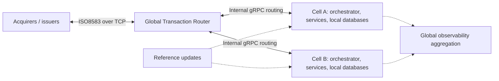
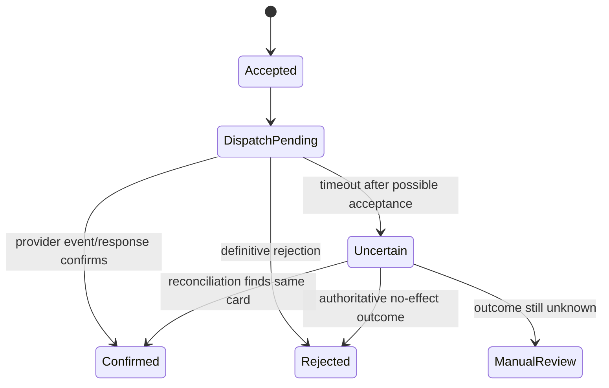

# Amex payments platform: disclosed internal architecture

Research date: 2026-09-08. This is a deeper technical follow-up to the product/workflow study. The strongest evidence comes from named Amex engineers describing systems they operate, supplemented by conference materials and a product approval record. These establish substantial parts of the internal design. They do not establish the entire enterprise topology, current database schemas or all issuer/acquirer services.

## What is actually disclosed

| Evidence | Specific finding | Scope and confidence |
|---|---|---|
| P01 — Amex, 2026-03-12 | The Global Transaction Router separates connection/routing responsibilities from payment processing. External ISO8583 traffic uses long-lived TCP connections; internal routing uses gRPC. Envoy and a custom control plane support progressive routing across platforms and regions. | Direct account by Benjamin Cane and Tristan Fuentes, payments-network engineering. Deployed-system assertion, not independent uptime measurement. |
| P02 — Amex, 2026-06-11 | Processing runs in independent cells with local services/databases, preloaded reference data and deterministic routing to appropriate dynamic state. Cross-cell replication and global telemetry aggregation are asynchronous. | Direct account by Benjamin Cane, core payments. A cell is a failure boundary and never spans regions; do not assume a universal cell-to-cluster ratio. |
| P03 — Amex, 2025-07-16 | Go services use an internal standard framework/toolkit for observability, health, shutdown and security; concurrency testing includes the race detector. | First-party engineering practices. The internal toolkit is not thereby available on GitHub. |
| P04 — Amex, 2019-11-25 | Go selection included an ISO8583-to-JSON benchmark and production pilots for payment/rewards systems. | Historical selection evidence. Benchmark request rates are not live authorization throughput. |
| P05 — CNCF, 2021-10-13 | An announcement with a named Amex infrastructure executive identifies Kubernetes, Prometheus and Envoy adoption and automated delivery. | Named-customer ecosystem evidence. It does not locate Prometheus in every current service. |
| P06 — EMVCo, 2020-09-10 | The approval names Amex TRS's Gravity ACS 2.2 and lists Red Hat OpenShift 3.1.1 as its platform. | Independent historical product-approval record; listed expiry 2022-08-04. It proves neither a current certification nor enterprise-wide OpenShift use. |
| P07 — Amex speakers, P99 2024 | The deck describes local database disks, Go for critical routing, HTTP/2/gRPC, and Envoy sidecars to address connection-level load-distribution problems. | Named-engineer slides published by conference organizer ScyllaDB; actual slide text read, not SlideShare's generated description. |
| P08 — Amex speaker, Monster Scale 2025 | GTR design uses Go, Protobuf/gRPC and asynchronous logging; profiling and release-by-release performance, failure and unexpected-traffic tests guide improvements. | Named-engineer slides. Conference hosting is not evidence Amex uses the organizer's database. |

Direct sources: [P01 network migration](https://americanexpress.io/migrating-the-payments-network-twice/), [P02 cell architecture](https://www.americanexpress.io/cell-based-architecture-for-resilient-payment-systems/), [P03 Go today](https://americanexpress.io/go-at-american-express-today/), [P04 Go selection](https://americanexpress.io/choosing-go/), [P05 CNCF announcement](https://www.cncf.io/announcements/2021/10/13/cloud-native-computing-foundation-welcomes-american-express-as-gold-member/), [P06 Gravity ACS approval](https://www.emvco.com/wp-content/uploads/loa/3DS_LOA_ACS_AMEX_020200_00315_10Sep20.pdf), [P07 latency slides](https://www.slideshare.net/slideshow/get-low-latency-by-benjamin-cane-and-tyler-wedin/272350368), [P08 routing slides](https://www.slideshare.net/slideshow/route-it-like-it-s-hot-scaling-payments-routing-at-american-express-by-benjamin-cane/276319457).

The event pages independently establish session provenance: [P09 P99 session](https://p99conf.io/session/get-low-latency/) and [P10 Monster Scale session](https://www.scylladb.com/tech-talk/route-it-like-its-hot-scaling-payments-routing-at-american-express/). Embedded videos were not watched. The public certificate's first page was rendered and visually checked; its unusual “Operating System Version” label is reported as written, without recasting OpenShift as a conventional OS.

## Simplified reconstruction of the disclosed network

This is our diagram of relationships in P01/P02, not Amex's original diagram. Labels deliberately omit unsupported vendors and undocumented services.

P02 makes recovery unusually explicit: processing can restart elsewhere before dispatch to an external system such as an issuer; after that boundary, rerouting is disallowed. Other payment flows use stable transaction identifiers to suppress duplicates. This is a more useful design constraint than a generic “retry on failure” box. The disclosure does not specify every failover-consistency mechanism or financial posting boundary. Replication transport is deliberately omitted from the diagram; it must not suggest unrestricted cross-cell communication.

P01 also explains operational change: insert the router forwarding to the incumbent processor, validate a separate system with shadow traffic, then progressively route eligible traffic with rollback. The later Kubernetes move reused traffic controls after infrastructure-as-code, performance and failure validation. Amex reports both migrations without customer-impacting downtime; this is an attributed result, not our measured SLA.

## Important distinctions when assembling the picture

**Network processing, issuer decisions, authentication, remittance, servicing and accounting are separate concerns.** The public core-network articles do not identify the credit-account ledger, underwriting engine, statements database or merchant payout processor. A Gravity ACS approval is about authentication; it is not an issuing processor certification. The vendor studies identify additional bounded systems. There is no evidence that all of them sit in one synchronous purchase path.

**Different publication dates can describe different generations.** The 2024 latency deck mentions preloaded/read-through cache patterns; the 2026 cell article explicitly avoids centralized fall-through reads in critical reference-data processing. Use the newer, more specific disclosure for that case. Preserve the older deck's date. Do not silently combine them into one exact current configuration. Likewise, OpenShift's 2020 approved-product version must not become an installation recommendation in 2026.

**Technical scale claims need their measurement boundary.** Language microbenchmarks, inference latency, router throughput, end-to-end authorization latency and settlement turnaround measure different things. This dossier does not adopt third-party “millions of transactions per second” summaries without a corresponding primary measurement. Nor does an Amex speaker at a database conference prove that database is deployed.

**A patent, open repository or engineer's talk is useful for different reasons.** Code establishes a component's actual behavior at a revision. A patent establishes a described invention, not deployment or permission to implement it. An operational talk can establish deployment but omit the code. The companion studies maintain those distinctions rather than using one evidence type to fill another's gaps.

## Proposed Etail architecture decisions arising from the research

The following is our engineering design, not a reconstruction of undisclosed Amex code. It preserves the project's modular monolith, PostgreSQL, one policy engine, one issuance command and one ledger. Amex's global deployment footprint is not required to implement the user's intended account, issuing and merchant experience.

### 1. Make the external-effect boundary explicit

For each provider command, persist one command identity, account/resource scope, intended effect and provider correlation before dispatch. Classify failures by whether an external effect could already exist. A transport timeout after dispatch must result in an uncertain state with reconciliation, not a new request identity or a success screen.

Before dispatch, Etail may already have persisted a reservation or another internal effect. Being before the external boundary is therefore not enough to justify replay: stable identity and unique business effects are required on both sides of that boundary.

Proposed lifecycle for a mock card issue:

`Uncertain` is a proposal for the executable contract, not a silent rename of existing normative states. Preserve the master card-request lifecycle and add a mapped operational substate if required. Retries reuse the business/provider idempotency identity where supported. Operator actions go through the same command and policy checks. A cancellation request must not erase an unresolved external effect.

Acceptance proposal: force a mock provider to create the card then lose its response; repeat the command and event; establish exactly one card, one issue effect and a recoverable user status. Kill the worker after dispatch and before local confirmation. Resume with the same identity and reconcile. This is simulation only.

### 2. Keep authoritative money and policy together

Within PostgreSQL, eligibility, backing reservations, limit consumption and the intended financial effect must commit atomically through the server command. Reporting, notifications and CRM projections follow durable events. Analytics or a delayed read model cannot approve spending. Reference-data snapshots need explicit versions and effective times; do not copy Amex's cache topology to solve a problem a local transaction already solves.

Acceptance proposal: concurrently change a limit and submit spending; verify committed order and capacity. A projection outage must not create a second ledger or make a stale dashboard authoritative. A worker crash between effect and acknowledgement must not duplicate posting. No database-engine substitution is implied by a vendor case study.

### 3. Separate durable audit from diagnostic telemetry

Financial effects, policy decisions, consent and operator changes require durable evidence. Debug logs, traces and metrics are diagnostic outputs. Slow diagnostics should not hold database locks or block normal work, but mandatory journal/audit persistence must never be dropped to improve latency. Alerts should expose lost diagnostic visibility. This distinction matters when adapting a network router's performance techniques to account administration.

Acceptance proposal: make the log/metrics sink fail while exercising an authorized mock command; retain the correct journal and audit record. Make mandatory persistence fail; the command must not claim success. Verify identifiers and amounts without exposing secrets or unnecessary personal data.

### 4. Replay safely before changing behavior

Create fictional golden scenarios for authorization, reversal, duplicate event, late clearing, freeze, dispute, payout and reconciliation. Run candidate rules against the same inputs in a side-effect-disabled comparison harness. Compare balances, ledger effects, capacities, statuses and reasons, not merely JSON shapes. Keep this inside the established commands/handlers; it must not become a second policy engine.

This is an adaptation of migration validation for a greenfield project. No old Etail source, database or customer-traffic replay is permitted. A shadow run must have zero provider writes, financial postings, emails or outbound customer notifications. Changing production routing or running real payment experiments is outside this research.

### 5. Design operations alongside the user journey

Every pending financial state needs a responsible queue, age, next permitted action, evidence and escalation condition. Separate operator approval from execution when the existing product requires it. Reconciliation needs the chain from request through provider reference and journal to consumer or merchant projection. Measure the time until an unresolved case is actionable, not only HTTP latency.

Acceptance proposal: an operator can distinguish never-dispatched, dispatched-but-unknown, rejected and confirmed cases; a viewer cannot execute recovery; evidence is scoped to the account; retry, correction and cancellation are audited. This is the connecting architecture between management operations and the 90-task experience catalog.

### 6. Defer physical distribution until a measured requirement

Define module and failure boundaries now. Consider independent processes, regions or cells only if measured capacity, recovery objectives, residency or operational isolation require them and a reviewed decision changes D03. A Netlify web/function deployment does not become an ISO8583 network switch by adding an Envoy dependency. If an authorized network adapter later requires persistent sockets, its hosting, protocol certification and service ownership require a separate design. None is implemented here.

## What to specify first

The next design artifact should be one executable end-to-end contract spanning: scoped account authority → saved card request → issue dispatch and recovery → backed mock authorization → clearing/reversal → journal → statement or merchant settlement → operator reconciliation. Specify identifiers, ownership, state transitions, external-effect boundaries and negative cases before introducing further infrastructure.

Implementation still follows M1 responsibility/grants, M2 card/ledger, M3 transaction/repayment, M4 merchant and M5 operations dependencies. See [ARCHITECTURE_BLUEPRINT.md](ARCHITECTURE_BLUEPRINT.md) for the cross-study synthesis and the proposed review gates.

## Sources not promoted to deployment evidence

OpenShift community participation and Red Hat/Sysdig logo slides do not locate a deployed system. A Cluster API webinar co-presented by an Amex engineer is general project education, not an Amex cloud topology. A HashiCorp page mentioning Amex-shaped card numbers is not an Amex customer case. Isracard's Red Hat deployment is a partner's system. Public CVs and job adverts remain leads, not verification. A search-indexed network specification explicitly marked confidential was excluded from technical extraction. Details are recorded in [platform-sources.json](platform-sources.json).
